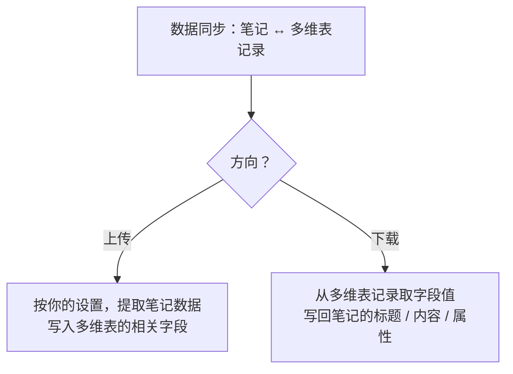
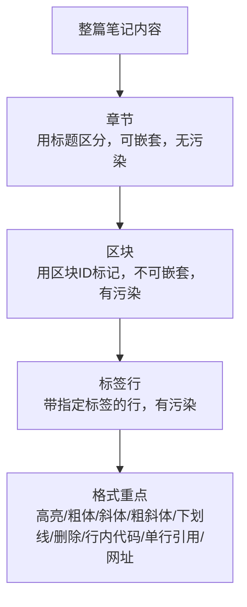

# IOTO 的数据同步功能：如何处理笔记与多维表中的数据

> [!info] 写给使用 IOTO 数据同步功能的你
> 本文帮你搞清楚一件事：IOTO 在「笔记」和「多维表记录」之间到底交换了哪些数据、怎么交换、又有哪些开关可以调。
> 读完后你就能更清楚地决定：要把笔记的哪些信息上传到多维表，又要从多维表里取回哪些信息写回笔记。

---

## 一句话先记住

> IOTO 的数据同步，本质上就是**把一篇 Obsidian 笔记里的数据，和一张多维表中的某条记录来回交换**。想用好它，最关键的是想清楚：你能从笔记里提取什么上传，又能从多维表里取回什么写回笔记。

---

## 同步的两个方向

数据交互只有两种动作：**上传**和**下载**。两者正好相反。

- **上传**：先按设置把一篇笔记「数据化」，再把处理后的数据写进指定的多维表字段。
- **下载**：反过来，从指定的多维表记录里拿到相关字段的值，再写回笔记的标题、内容或属性。

---

## 默认会提取的基本数据

同步一篇笔记时，IOTO 默认会先把以下信息提取出来：

| 默认提取的数据  | 说明           |
| -------- | ------------ |
| 笔记标题     | 笔记的文件名       |
| 笔记内容     | 不含属性区的正文     |
| 笔记全文     | 含属性区 + 正文    |
| 笔记标签     | 属性区或正文中添加的标签 |
| 笔记别名     | 属性区设置的别名     |
| 笔记路径     | 库中的绝对路径      |
| 所在库      | Obsidian 库名  |
| OBURI 链接 | 默认规范的 URI 链接 |
| 创建时间     | 元数据中的创建时间    |
| 更新时间     | 元数据中的更新时间    |

### 你能控制的部分

以上信息默认都会同步，但下面几项你可以开关：

| 可控制项 | 说明 |
| --- | --- |
| 是否用多维表标题作为笔记标题 | 可关 |
| 是否同步内容 | 可关 |
| 是否同步全文 | 可关 |

> [!note] 其余基本数据默认双向同步
> 除上述三项外，其他基本数据在**当前版本中是双向同步且不能关闭**的。

### 建议：把默认字段都留在多维表里

> [!tip] 即使暂时不用，也建议保留这些默认字段
> 1. **方便将来启用** —— 以后想开某个同步项，字段现成，直接开。
> 2. **不占地方** —— 任意多维表都支持建几百个字段；用「视图」把暂时不用的字段隐藏即可，完全不影响使用。
>
> 想改这些默认字段的名字，见 [[S8-如何修改默认同步字段的名称]]。

---

## 获取内容字段：让多维表帮你处理笔记内容

同步设置里有一项**获取内容字段**，默认值是 `内容`。

- **上传时**：笔记内容写入 `内容` 字段。
- **下载时**：默认用 `内容` 字段覆盖你的笔记正文。

但你可以把这项改掉。典型用法：**接入多维表的 AI 字段**。

> [!example] 用「AI 内容」字段做自动润色
> 1. 在多维表里建一个 AI 字段，命名为 `AI内容`，规则设为「当内容变化时，按你的要求优化/处理」。
> 2. 把**获取内容字段**改为 `AI内容`。
> 3. 在 Obsidian 里写笔记 → 上传 → 多维表侧 AI 自动处理。
> 4. 下载时，用 `AI内容` 字段覆盖你的笔记正文。
> 5. 你在处理后的内容上继续改 → 再上传 → AI 再次处理 → 再下载覆盖。
>
> 这样就形成了一个「写 → AI 处理 → 取回 → 再写」的循环。

---

## 自定义属性：同步你自己的字段

在基本数据中，**标签**和**别名**是 Obsidian 自带的两个属性。除此之外，你也可以把自己定义的属性同步到多维表。

> 具体如何把指定属性同步到多维表，见 [[S8-如何把指定的笔记属性同步到多维表——自定义字段的使用]]。

---

## 属性获取字段：只从多维表取回属性

有些场景下，你只希望把多维表里某些字段的值**取回来写进笔记属性**，这些属性你既不会在 Obsidian 里改，也不会从笔记上传到多维表。

这时就用**属性获取字段**的设置：在同步脚本里填一个「想要获取的字段名数组」，下载时 IOTO 会按这些字段名，把值写进 Obsidian 笔记的属性。

---

## 附加内容：把多维表内容追加到笔记末尾

和「属性获取字段」类似，有时你想把多维表里某些字段的内容**下载并附加到原笔记内容的后面**，就用**附加内容**设置。

> [!warning] 上传时不会计入正文
> 附加的内容，在**上传时不会被算进笔记内容**。它只在下载时追加到笔记后面，不会反过来影响你上传的数据。

---

## 提取内容：整篇上传，或只取其中一部分

你可以把整篇笔记内容作为一个整体，上传到多维表的一个字段；也可以对内容进行**拆分和标记**，把需要的部分上传到指定的字段。

按「范围从大到小」，可拆的维度如下：

| 维度 | 标记方式 | 可否嵌套 | 是否污染原文 |
| --- | --- | --- | --- |
| 章节 | 用标题区分 | 可嵌套 | 不会 |
| 区块 | 用 Obsidian 区块 ID | 不可嵌套 | 会（区块 ID） |
| 标签行 | 带指定标签的行 | — | 会（标签） |
| 格式重点 | 高亮 / 斜体 / 粗体 / 粗斜体 / 下划线 / 删除语法 / 行内代码 / 单行引用 / 网址 | — | 会（标记语法） |

> 所谓「污染」，指标记本身（如区块 ID、标签）会出现在笔记的内容里。
> 章节因为靠标题划分，不会往正文塞额外信息，是最「干净」的拆分方式。

这些格式重点在设置里也可以被单独提取到对应的字段。

---

## 给新手的推荐做法

1. **先保留全部默认字段**：别急着删多维表里的默认字段，将来要用随时能开。
2. **想清楚双向还是单向**：只想把笔记备份/分享出去，就关注「上传」；想让多维表反向驱动笔记（如 AI 处理、回写属性），就关注「下载」相关的设置（获取内容字段 / 属性获取字段 / 附加内容）。
3. **内容提取注意颗粒度**：提取笔记内容的时候，可以根据自己的需求设置不同的颗粒度，章节提取和要点提取，不会在你的笔记中添加额外的内容，更推荐使用。

---