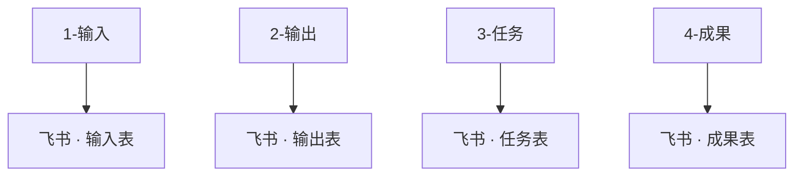

# 一步步教你如何设置 IOTO 的 4 个基本文件夹与不同的飞书多维表进行同步

> [!info] 写给想要「分表同步」的你
> 如果你已经掌握了 IOTO 与飞书的**基础**同步，现在想把 Obsidian 里 4 个基本文件夹下的笔记，分别存到**不同的飞书多维表**中，这篇就是给你看的。跟着下面的四步走，就能配好。

---

## 一句话先记住

> [!note]
> 想要「一个文件夹对应一张表」，核心只做两件事：
> 1. 在飞书里多建几张**结构相同**的数据表；
> 2. 在同步脚本生成器中，给每个文件夹分别指定对应的 `Table ID`。

## 整体思路：文件夹与数据表一一对应

把每个 IOTO 基本文件夹，映射到一张独立的飞书多维表：

> 上面只是示例，具体映射按你实际的文件夹与表名来定。重点不是有 4 张表，而是「每建一张表，就对应一个要同步的文件夹」。

## 第一步：创建需要的多维表

在飞书中，你可以使用多维表的「复制数据表」功能，在之前已经建好的数据表基础上，快速创建新的数据表。

点击「复制数据表」后，在弹出的窗口中输入新数据表的名称，并选择「仅数据结构」，最后点击「复制」按钮。

按照同样的流程，把其余几个数据表也一并准备好。

## 第二步：在默认模板的基础上创建你的自定义同步模板

IOTO 提供的默认飞书同步模板是 [[My-TP-OBSyncFeishu]]。

在默认模板上点击右键，使用「创建副本」功能，生成你自己的自定义同步模板。

> [!warning] 别忘了改前缀
> 把自定义模板的**前缀**，改成你自己在 **IOTO Framework Settings** 插件中设置的前缀，否则同步会对应不上。

## 第三步：使用同步脚本生成器加载你的飞书自定义同步脚本

如果你还没有安装同步脚本生成器，可以参考 [[S8-一步步教你如何配置IOTO的4个基本文件夹与不同的Airtable数据表进行同步]] 中的介绍进行安装。

## 第四步：在同步脚本生成器中配置不同文件夹的数据表 ID

切换到「文件夹设置」，点击「添加文件夹设置」，在设置项中点击「文件夹路径」右侧的文件夹图标，选择 `1-输入`。

按照之前学过的方式，拿到你的「输入表」的 `Table ID`，填入「数据表 ID」设置中。

重复以上流程，把其他几个文件夹也逐一设置好，然后点击右上角的「生成同步脚本」按钮。

在弹出的预览窗口中检查你的设置，确认内容与下图类似后，点击「更新」按钮，更新你的**飞书自定义同步脚本**。

---

完成以上设置后，你就可以把 4 个基本文件夹下的笔记，分别同步到不同的飞书多维表了。