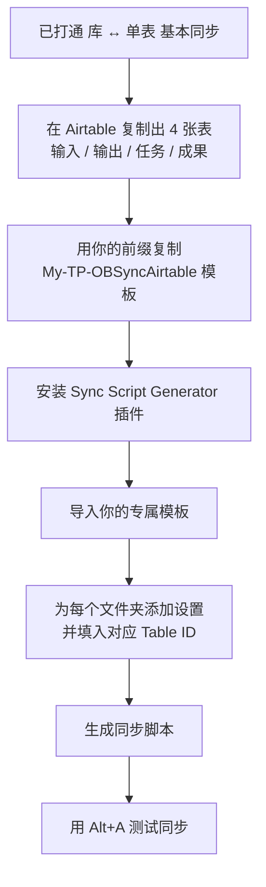

# 一步步教你如何配置 IOTO 的 4 个基本文件夹与不同的 Airtable 数据表进行同步

> [!info] 写给已经打通「IOTO ↔ Airtable 基本同步」的你
> 如果你已经按 [[S8-手把手教你如何配置IOTO与Airtable的基本同步]] 把整个库和一个 Airtable 表打通，那只是「整库 ↔ 单表」的最基本同步。本篇教你更进一步：把 IOTO 的 4 个一级文件夹（输入 / 输出 / 任务 / 成果）分别同步到 4 张不同的 Airtable 表。读完你将学会：① 在 Airtable 准备 4 张表；② 制作个人版同步模板；③ 安装同步脚本生成器；④ 把 4 个文件夹分别映射到对应表；⑤ 测试验证。

---

## 一句话先记住

> [!tip] 核心思路
> 复制出 4 张表（输入 / 输出 / 任务 / 成果）→ 用你的**用户前缀**做一个专属同步模板 → 用「同步脚本生成器」把 4 个文件夹分别指向对应表的 Table ID → 一键生成脚本。

整体流程如下：

## 你会用到的前置条件

- 已完成 IOTO ↔ Airtable 基本同步（参考 [[S8-手把手教你如何配置IOTO与Airtable的基本同步]]）。
- 你的**用户前缀**：在 IOTO Framework Settings 中设置，演示库中使用 `JL`，实际操作请换成你自己的前缀。
- IOTO 提供的 Airtable 同步模板：[[My-TP-OBSyncAirtable]]。

## 文件夹与数据表的对应关系

配置的本质，就是让下面这 4 组一一对应：

| IOTO 文件夹 | Airtable 表名 | 同步内容 |
| --- | --- | --- |
| `1-输入` | `输入` | 输入型笔记 |
| `2-输出` | `输出` | 输出型笔记 |
| `3-任务` | `任务` | 任务笔记 |
| `4-成果` | `成果` | 成果笔记 |

---

## 第一步：在 Airtable 创建 4 张数据表

你现在应该已经有一张基于 IOTO 模板创建的 Airtable 数据表。我们先把它改名，再复制出另外三张。

1. 在原有数据表的名字上点右键，选择 `Rename table`，改名为 `输入`。

2. 在 `输入` 表的名字上点右键，选择 `Duplicate table`。

3. 在弹出的确认窗口中直接点 `Duplicate table`。

4. 把新复制出来的表重命名为 `输出`。重复上面的「复制 + 重命名」操作，再准备好 `任务` 和 `成果` 两张表。

现在你已经准备好了 4 张数据表，接下来需要在 IOTO 库中配置 Airtable 同步脚本。

---

## 第二步：创建个人定制版 Airtable 同步模板

IOTO 的同步模板采用和其他模板一样的加载逻辑：**先找以你在 IOTO Framework Settings 中设置的用户前缀开头的版本；找不到时，才退回到以 `My` 开头的默认模板。**

例如，演示库中我使用的前缀是 `JL`：

我们到 `MyIOTO/同步模板` 下找到模板 [[My-TP-OBSyncAirtable]]：

选中后，点右键选择 `创建副本`，把它重命名为 `JL-TP-OBSyncAirtable`。（实际使用过程中，请使用你**自己的用户前缀**去重命名。）

> [!warning] 命名一定要用你自己的前缀
> 模板名前缀必须和 IOTO Framework Settings 里的用户前缀一致，否则 IOTO 在加载时会找不到你的专属模板，而退回到默认的 `My` 版本。

---

## 第三步：安装 IOTO 同步脚本生成器插件

为了方便配置同步模板，我开发了 `Sync Script Generator` 插件。

1. 用 `Ctrl+P`（或 `Command+P`）打开 Obsidian 命令面板，输入 `IOTO Update`，找到「安装同步脚本生成器」选项并确认。

2. 安装成功后，你会在 Obsidian 左侧工具栏看到两个新图标：一个是**同步脚本（模板）生成器**，另一个是**获取脚本（模板）生成器**。

3. 点击**同步脚本生成器**，在 Airtable 设置页点击「导入」按钮，选择以你的前缀开头的 Airtable 同步模板。

4. 模板加载成功后，你会看到一个「当前文件」的提示，说明模板已正确载入。

---

## 第四步：配置 4 个文件夹分别同步到对应表

1. 把同步脚本生成器切换到 `文件夹设置` 项，然后点击 `添加文件夹设置` 按钮。

2. 在出现的文件夹设置中，点击 `文件夹路径` 右侧的文件夹图标，选择 `1-输入`。

3. 在下面的基础设置里，于 `数据表 ID` 中输入你 Airtable 中「输入」表的 Table ID。

> [!note] Table ID 的格式
> Table ID 是以 `tbl` 开头的字符串（例如 `tblXXXXXXXXXXXXXX`），在 Airtable 表的具体地址或 API 文档中可以找到。

4. 重复「添加文件夹设置 + 填入对应 Airtable 表」的操作，把 `2-输出`、`3-任务`、`4-成果` 三个文件夹也设置好。

5. 全部设置完成后，点击右上角的 `生成同步脚本` 按钮。

6. 在弹出的预览窗口中，你可以核对刚才设置的具体内容。

7. 确认无误后，点击右下角的「更新」按钮，即可完成设置。IOTO 会自动更新以你的前缀开头的模板文件。

---

## 第五步：测试验证

1. 在任意笔记中，用 `Alt+3` 创建一个某项目的任务笔记。
2. 在其中按 `Alt+A`（或 `Option+A`）去同步这个任务笔记。如果它被正确同步到了你的「任务」表中，就证明配置成功。
3. 你还可以分别在某个**输入**、**输出**或**成果**笔记里重复测试，确保 4 个一级文件夹都正确同步到了对应的 Airtable 数据表。

> [!tip] 只要有一个文件夹同步失败，就重点检查
> 该文件夹设置里填的 `数据表 ID` 是否写错（必须是以 `tbl` 开头），以及模板名前缀是否和你的用户前缀一致。

---