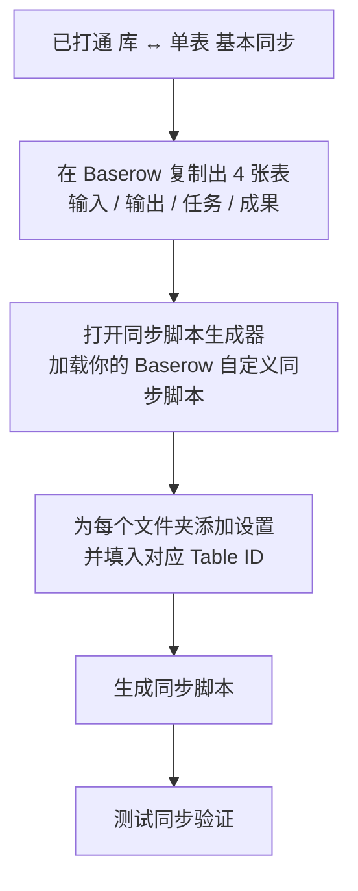

# 一步步教你如何配置 IOTO 的 4 个基本文件夹与不同的 Baserow 数据表进行同步

> [!info] 写给已经打通「IOTO ↔ Baserow 基本同步」的你
> 如果你已经按 [[S8-手把手教你如何配置IOTO与Baserow的同步]] 把整个库和一个 Baserow 数据表打通，那只是「整库 ↔ 单表」的最基本同步。本篇教你更进一步：把 IOTO 的 4 个一级文件夹（输入 / 输出 / 任务 / 成果）分别同步到 4 张不同的 Baserow 数据表。读完你将学会：① 在 Baserow 准备 4 张表；② 用「同步脚本生成器」加载你的 Baserow 自定义同步脚本；③ 把 4 个文件夹分别映射到对应表的 Table ID；④ 测试验证。

---

## 一句话先记住

> [!tip] 核心思路
> 复制出 4 张表（输入 / 输出 / 任务 / 成果）→ 用「同步脚本生成器」加载你的 Baserow 自定义同步脚本 → 把 4 个文件夹分别指向对应表的 Table ID → 一键生成脚本。

整体流程如下：

## 你会用到的前置条件

- 已完成 IOTO ↔ Baserow 基本同步（参考 [[S8-手把手教你如何配置IOTO与Baserow的同步]]）。基本同步时，你已经基于默认模板 [[My-TP-OBSyncBaserow]] 创建好了自己的自定义同步模板——前缀为你设置的用户模板前缀，演示库中使用 `JL`，即 `JL-TP-OBSyncBaserow`。
- 已安装「同步脚本生成器」插件。如果之前没有安装过，可以参考 [[S8-一步步教你如何配置IOTO的4个基本文件夹与不同的Airtable数据表进行同步]] 中的介绍进行安装。

## 文件夹与数据表的对应关系

配置的本质，就是让下面这 4 组一一对应：

| IOTO 文件夹 | Baserow 表名 | 同步内容 |
| --- | --- | --- |
| `1-输入` | `输入` | 输入型笔记 |
| `2-输出` | `输出` | 输出型笔记 |
| `3-任务` | `任务` | 任务笔记 |
| `4-成果` | `成果` | 成果笔记 |

---

## 第一步：在 Baserow 创建需要的数据表

最省事的做法是：你已经有一张在基本同步里建好的数据表，直接在它基础上复制出另外几张。

1. 在你的数据表上，使用 Baserow 的 `Duplicate` 功能，在已有数据表的基础上创建一张新的数据表。

2. 如果复制出来的数据表里带有不需要的旧记录，可以选中后，使用右键菜单批量删除。

3. 点击复制出来的数据表右侧的三个小点，然后重命名。

4. 重复上面的步骤，把你需要的数据表都准备好（输入 / 输出 / 任务 / 成果）。

现在你已经准备好了 4 张数据表，接下来需要在 IOTO 库中配置 Baserow 同步脚本。

---

## 第二步：使用同步脚本生成器加载你的 Baserow 自定义同步脚本

为了方便配置同步模板，我开发了「同步脚本生成器」插件。如果你还没有安装，可以参考 [[S8-一步步教你如何配置IOTO的4个基本文件夹与不同的Airtable数据表进行同步]] 中的介绍进行安装。

1. 打开同步脚本生成器，加载你在基本同步时创建的 Baserow 自定义同步脚本（即你的 `XX-TP-OBSyncBaserow` 模板，演示库中为 `JL-TP-OBSyncBaserow`）。

---

## 第三步：在同步脚本生成器中配置不同文件夹的 Table ID

1. 切换到 `文件夹设置`，然后点击 `添加文件夹设置`。在出现的设置中，点击 `文件夹路径` 设置右侧的文件夹图标，选择 `1-输入`。

2. 按照之前学过的方式，拿到你的「输入」表的 `Table ID`，把它输入到 `数据表 ID` 的设置中。

> [!note] Table ID 是什么 / 在哪找
> Table ID 是 Baserow 数据表的唯一标识。在 Baserow 数据表的 URL 中，`table` 后面两个 `/` 之间的数字就是 Table ID（例如 `…/table/123456/` 中的 `123456`）。请确认复制的 ID 与对应表完全匹配。

3. 重复上面的流程，把 `2-输出`、`3-任务`、`4-成果` 几个文件夹也一一设置好，然后点击右上角的 `生成同步脚本` 按钮。

4. 在出现的预览窗口中，仔细检查你的设置是否和下面的示例一致：每个文件夹都正确指向了对应的 Baserow 表。

5. 确认无误后，点击 `更新` 按钮，IOTO 就会自动更新以你的前缀开头的 Baserow 自定义同步脚本。

---

## 第四步：测试验证

1. 回到 Obsidian，在 `1-输入`、`2-输出`、`3-任务`、`4-成果` 下各打开或创建一个笔记，运行 IOTO 的 Baserow 同步命令。
2. 打开对应的 Baserow 数据表，确认该笔记被正确同步到了相应的表中。
3. 四个文件夹都验证通过后，配置即告完成——此后 4 个基本文件夹下的笔记，就会分别同步到不同的 Baserow 数据表了。

> [!tip] 只要有一个文件夹同步失败，就重点检查
> 该文件夹设置里填的 `数据表 ID` 是否写错（需与对应 Baserow 表的 ID 完全一致），以及你的自定义同步模板前缀是否和设置的用户模板前缀一致。

---