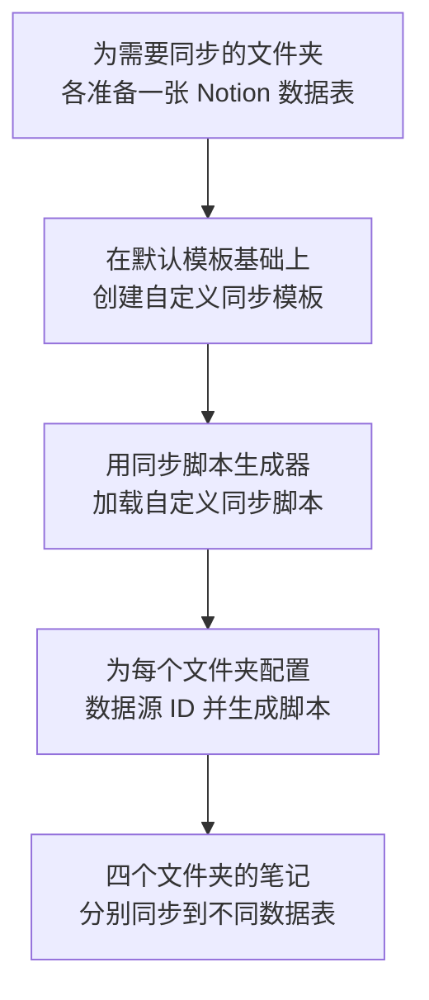

# 一步步教你如何配置 IOTO 的 4 个基本文件夹与不同的 Notion 数据表进行同步

> [!info] 写给想把笔记分门别类同步到 Notion 的你
> 如果你已经会用 IOTO 做基础的 Notion 同步，但希望 **`1-输入` / `2-输出` / `3-任务` / `4-成果` 这四个文件夹各同步到一张独立的 Notion 数据表**，这篇就是给你看的。
> 整体流程和 [[S8-一步步教你如何配置IOTO的4个基本文件夹与不同的Airtable数据表进行同步]] 类似，区别只在于目标数据库是 Notion。

---

## 一句话先记住

> 想让不同文件夹同步到不同 Notion 表，核心就四步：**多建几张表 → 在默认模板上复制出自定义模板 → 用同步脚本生成器加载 → 给每个文件夹配好数据源 ID 再生成脚本。**

整体流程如下：

---

## 第一步：为每个文件夹创建对应的数据表

如果你已经有了基础同步用的那张 Notion 数据表，最省事的做法是**以它为蓝本复制出多张新表**，而不是从零搭建。

1. 在 Notion 中打开已有的数据表，使用「创建副本」功能新建一张表。
2. 创建时务必选择 **`创建不含内容的副本`**，只继承结构、不把旧数据带过来。

> [!warning] 自建应用访问令牌（Internal Integration Token）要逐个授权
> 如果你使用的是「自建应用的访问令牌」，新建出来的数据表**默认不会**自动继承之前的集成权限。你需要到这张新表的「集成」设置里，**逐个添加你之前创建的应用**，否则同步时会拿不到数据。

---

## 第二步：在默认模板基础上创建你的自定义同步模板

IOTO 自带一个默认的 Notion 同步模板 **[[My-TP-OBSyncNotion]]**，我们不需要改它，而是在它上面复制出自己的版本。

1. 在默认模板上点击右键，选择「创建副本」，生成你自己的自定义同步模板。
2. **关键一步**：把自定义模板的前缀，改成你在 **IOTO Framework Settings 插件**中设置的前缀。前缀对不上，模板就不会作用到你的配置上。

> [!tip] 为什么要复制而不是改默认模板？
> 保留默认模板，等于保留了一个随时可对照的「标准答案」。你的自定义模板改坏了，还能重新复制一份，不影响其他人或基础流程。

---

## 第三步：用同步脚本生成器加载你的 Notion 自定义同步脚本

打开 **同步脚本生成器**，加载你在第二步创建的 Notion 自定义同步脚本。

> [!note] 还没装同步脚本生成器？
> 可参考 [[S8-一步步教你如何配置IOTO的4个基本文件夹与不同的Airtable数据表进行同步]] 中关于安装生成器的介绍，先把工具装上再来这一步。

---

## 第四步：为每个文件夹配置数据源 ID 并生成脚本

这一步的目的是告诉生成器：**哪个文件夹，对应哪张 Notion 表**。我们以 `1-输入` 为例：

1. 在生成器中切换到 **`文件夹设置`**。
2. 点击 **`添加文件夹设置`**。
3. 在出现的设置里，点击「文件夹路径」右侧的**文件夹图标**，选择 `1-输入`。

4. 按之前学过的方式，拿到 `1-输入` 对应的那张 Notion 表的 **`Data Source ID`**，把它填进「数据源 ID」设置中。

5. **对 `2-输出`、`3-任务`、`4-成果` 等其他几个文件夹，重复上面的流程**，各自绑定对应的数据表。
6. 全部设好后，点击右上角的 **`生成同步脚本`** 按钮。
7. 在弹出的预览窗口里检查配置。如果看到类似下图的设置，就可以点击 **`更新`** 按钮，把你的 Notion 自定义同步脚本更新生效了。

---

## 完成之后

按上面的流程设置完成后，你就可以把 **四个基本文件夹下的笔记，分别同步到不同的 Notion 数据表** 了——`1-输入` 去输入表，`2-输出` 去输出表，依此类推，互不串门。

> [!tip] 改配置别忘了重新「生成 + 更新」
> 之后只要新增或调整了某个文件夹对应的表，回到同步脚本生成器**重新生成并更新脚本**即可，无需从头再来一遍前几步。

---