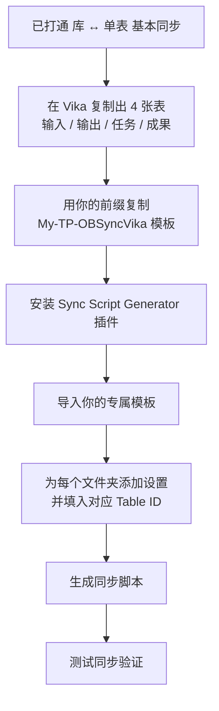

# 一步步教你如何配置 IOTO 的 4 个基本文件夹与不同的 Vika 数据表进行同步

> [!info] 写给已经打通「IOTO ↔ Vika 基本同步」的你
> 如果你已经按 [[S8-手把手教你如何配置IOTO与Vika的基本同步]] 把整个库和一个 Vika 数据表打通，那只是「整库 ↔ 单表」的最基本同步。本篇教你更进一步：把 IOTO 的 4 个一级文件夹（输入 / 输出 / 任务 / 成果）分别同步到 4 张不同的 Vika 数据表。读完你将学会：① 在 Vika 准备 4 张表；② 制作个人版同步模板；③ 安装同步脚本生成器；④ 把 4 个文件夹分别映射到对应表的 Table ID；⑤ 测试验证。

---

## 一句话先记住

> [!tip] 核心思路
> 复制出 4 张表（输入 / 输出 / 任务 / 成果）→ 用你的**用户前缀**做一个专属同步模板 → 用「同步脚本生成器」把 4 个文件夹分别指向对应表的 Table ID → 一键生成脚本。

整体流程如下：

## 你会用到的前置条件

- 已完成 IOTO ↔ Vika 基本同步（参考 [[S8-手把手教你如何配置IOTO与Vika的基本同步]]）。
- 你的**用户前缀**：在 IOTO Framework Settings 中设置，演示库中使用 `JL`，实际操作请换成你自己的前缀。
- IOTO 提供的 Vika 同步模板：[[My-TP-OBSyncVika]]。

## 文件夹与数据表的对应关系

配置的本质，就是让下面这 4 组一一对应：

| IOTO 文件夹 | Vika 表名 | 同步内容 |
| --- | --- | --- |
| `1-输入` | `输入` | 输入型笔记 |
| `2-输出` | `输出` | 输出型笔记 |
| `3-任务` | `任务` | 任务笔记 |
| `4-成果` | `成果` | 成果笔记 |

---

## 第一步：在 Vika 创建需要的数据表

在 Vika 中，最省事的做法是：先有一张基于 IOTO 模板创建好的数据表，然后在它基础上复制出另外几张。

1. 在你的数据表名字上点右键，选择 `复制一份`，即可在原有数据表的基础上创建一张新的数据表。

2. 如果复制出来的数据表里带有之前的旧数据，你可以自行删除，只保留干净的表结构。

3. 重复上面的「复制一份」操作，把你需要的几张表都创建好（输入 / 输出 / 任务 / 成果）。

现在你已经准备好了 4 张数据表，接下来需要在 IOTO 库中配置 Vika 同步脚本。

---

## 第二步：在默认模板基础上创建你的自定义同步模板

IOTO 的同步模板采用和其他模板一样的加载逻辑：**先找以你在 IOTO Framework Settings 中设置的用户前缀开头的版本；找不到时，才退回到以 `My` 开头的默认模板。**

IOTO 提供的默认 Vika 同步模板是 [[My-TP-OBSyncVika]]：

在默认模板上点右键，使用 `创建副本` 的功能，创建你自己的自定义同步模板。

> [!warning] 命名一定要用你自己的前缀
> 复制后，请把自定义模板的前缀，改成你自己在 IOTO Framework Settings 插件中设置的前缀（例如演示库里使用 `JL`，就命名为 `JL-TP-OBSyncVika`）。模板名前缀必须和用户前缀一致，否则 IOTO 在加载时会找不到你的专属模板，而退回到默认的 `My` 版本。

---

## 第三步：安装并使用同步脚本生成器加载你的 Vika 自定义同步脚本

为了方便配置同步模板，我开发了「同步脚本生成器」插件。如果你还没有安装，可以参考 [[S8-一步步教你如何配置IOTO的4个基本文件夹与不同的Airtable数据表进行同步]] 中的介绍进行安装。

1. 打开同步脚本生成器，导入你刚才创建的 Vika 自定义同步模板。

模板加载成功后，你会看到「当前文件」的提示，说明模板已正确载入，接下来就可以为不同文件夹配置对应的数据表了。

---

## 第四步：在同步脚本生成器中配置不同文件夹的数据表 ID

1. 切换到 `文件夹设置`，然后点击 `添加文件夹设置`。在出现的设置中，点击 `文件夹路径` 设置右侧的文件夹图标，选择 `1-输入`。

2. 按照之前学过的方式，拿到你的「输入」表的 `Table ID`，把它输入到 `数据表 ID` 的设置中。

> [!note] Table ID 是什么 / 在哪找
> Table ID 是 Vika 数据表的唯一标识，在 Vika 数据表的地址栏或 API 文档中可以找到（通常为 `dst` 开头的字符串）。请确认复制的 ID 与对应表完全匹配。

3. 重复上面的流程，把 `2-输出`、`3-任务`、`4-成果` 几个文件夹也一一设置好，然后点击右上角的 `生成同步脚本` 按钮。

4. 在出现的预览窗口中，仔细检查你的设置是否和下面的示例一致：每个文件夹都正确指向了对应的 Vika 表。

5. 确认无误后，点击 `更新` 按钮，IOTO 就会自动更新以你的前缀开头的 Vika 自定义同步脚本。

---

## 第五步：测试验证

1. 回到 Obsidian，在 `1-输入`、`2-输出`、`3-任务`、`4-成果` 下各打开或创建一个笔记，运行 IOTO 的 Vika 同步命令。
2. 打开对应的 Vika 数据表，确认该笔记被正确同步到了相应的表中。
3. 四个文件夹都验证通过后，配置即告完成——此后 4 个基本文件夹下的笔记，就会分别同步到不同的 Vika 数据表了。

> [!tip] 只要有一个文件夹同步失败，就重点检查
> 该文件夹设置里填的 `数据表 ID` 是否写错（需与对应 Vika 表的 ID 完全一致），以及模板名前缀是否和你的用户前缀一致。