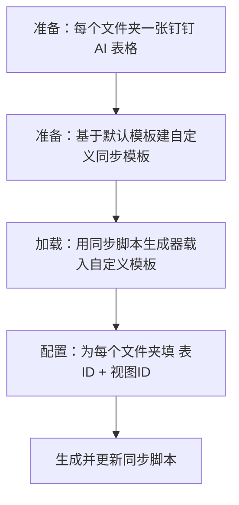

# 一步步教你如何配置IOTO的4个基本文件夹与不同的钉钉AI表格进行同步

> [!info] 写给想把 Obsidian 的 4 个基本文件夹，分别同步到不同钉钉 AI 表格的你
> 按「准备数据表 → 准备模板 → 加载脚本 → 配置字段」四步走，每一步都配有截图。读完你就能把 `1-输入` / `2-输出` / `3-任务` / `4-成果` 下的笔记，分别同步进不同的钉钉 AI 表格。

---

## 一句话先记住

> 想让不同文件夹同步到不同表格，核心是：**为每张表准备一个副本，再为每个文件夹配一套「表 ID + 视图 ID」**。整体流程与 [[S8-一步步教你如何配置IOTO的4个基本文件夹与不同的Airtable数据表进行同步|同步到 Airtable]] 几乎一样，只是数据源换成了钉钉 AI 表格。

## 整体流程

## 前置条件

- 已装好 IOTO 的**同步脚本生成器**（没装的话，参考 [[S8-一步步教你如何配置IOTO的4个基本文件夹与不同的Airtable数据表进行同步]] 里的安装说明）。
- 已知晓 IOTO 的 4 个基本文件夹：`1-输入` / `2-输出` / `3-任务` / `4-成果`。

---

## 第一步：创建需要的多维表

在钉钉 AI 表格里，利用「创建副本」功能，在已有数据表的基础上复制出新表，避免从零搭结构。

点击「创建副本」后，在弹窗里输入新表名，勾选 **仅数据结构**，再点「复制」。

按同样的流程，把其余几张表也准备好。

> [!tip] 选「仅数据结构」而不是整表复制，能省掉示例数据，只保留字段结构，后续同步更干净。

## 第二步：基于默认模板创建你的自定义同步模板

IOTO 提供的默认钉钉同步模板是 [[My-TP-OBSyncDing]]。

在默认模板上右键，用「创建副本」生成你自己的自定义同步模板。

> [!warning] 别忘了把自定义模板的**前缀**，改成你在 IOTO Framework Settings 插件里设置的前缀，否则同步会找不到对应表。

## 第三步：用同步脚本生成器加载自定义同步脚本

打开同步脚本生成器，载入你刚才的钉钉自定义同步模板。

> [!note] 如果还没安装同步脚本生成器，按 [[S8-一步步教你如何配置IOTO的4个基本文件夹与不同的Airtable数据表进行同步]] 里的步骤先装上。

## 第四步：为不同文件夹配置数据表 ID 和视图 ID

切到「文件夹设置」，点「添加文件夹设置」，在「文件夹路径」右侧点文件夹图标，选择 `1-输入`。

按之前学过的方式，拿到输入表的 `Table ID` 和 `View ID`，分别填进「数据表 ID」和「视图 ID」。

重复上面的流程，把其余几个文件夹也配好，然后点右上角「生成同步脚本」。

在预览窗口里核对设置，确认无误后点「更新」，即可更新你的钉钉 AI 表格自定义同步脚本。

---

## 收尾

按上面的流程配置完，你就可以把 4 个基本文件夹下的笔记，分别同步到不同的钉钉 AI 表格了。