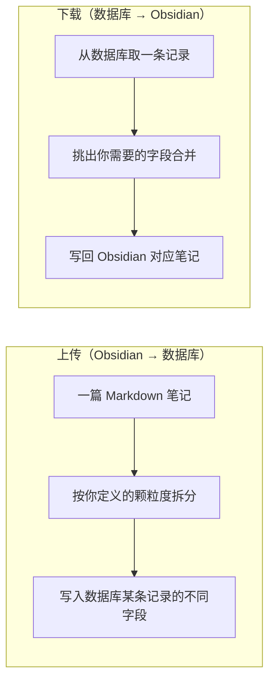
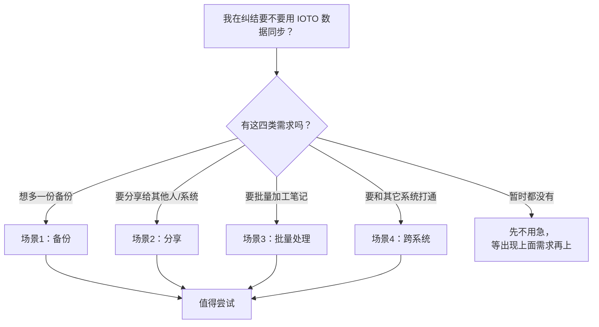

# 你是否需要使用 IOTO 的数据同步能力

> [!info] 写给正在纠结「要不要上数据同步」的你
> 本文帮你在动手之前先判断：IOTO 的数据同步能力到底解决了什么问题、适不适合你现在的阶段。读完后你应能自己回答「我需不需要现在就用」。

---

## 一句话先记住

> IOTO 的数据同步**不是人人都要马上用**。它解决的是「把笔记变成结构化数据、再拿去备份 / 分享 / 批量处理 / 跨系统打通」这一类需求。先弄清它是什么、能做什么、常见场景，再按自己的实际情况决定。

---

## 判断前，先弄清三件事

为了帮你做判断，建议先搞明白下面三点，答案自然就出来了：

1. **IOTO 的数据同步能力是什么？** —— 它和你熟悉的「云盘同步」根本不是一回事。
2. **它能做什么？** —— 颗粒度多细、范围多大。
3. **常见使用场景有哪些？** —— 看别人的真实用法对不对得上你的需求。

---

## 一、它是什么：不是文件同步，而是数据同步

先说**它不是什么**：IOTO 的数据同步**不是基于文件的同步**。

它和你用的 Obsidian 官方同步、iCloud、OneDrive、WPS 云盘这类「整文件复制」完全不同——那些工具只是把 `.md` 文件原样搬来搬去；而 IOTO 是把笔记**拆成结构化数据**再进出数据库。

整个能力建立在两个动作上：

- **上传**：把一篇 Markdown 拆成不同数据，逐字段同步到数据库的某一条记录里。你可以自己决定拆到多细。
- **下载**：从数据库取一条记录，把你指定的字段合并后，写回 Obsidian 对应的笔记里。你可以只挑需要的字段。

> [!tip] 灵活点在这两处
> 上传时**自定义拆分粒度**，下载时**挑选字段**——这是 IOTO 同步和「整文件复制」最本质的区别：你拿到的是可精细化管理的结构化数据，而不是一团文本。

**支持的数据库平台：**

| 类型 | 平台 |
| --- | --- |
| 主流在线多维表 | Airtable、飞书多维表、Notion、钉钉 AI 表格 |
| 可本地化部署 | Vika、Baserow 等相对小众但支持自部署的产品 |

---

## 二、它能做什么：颗粒度 + 范围

### 2.1 同步的颗粒度（能拆多细）

**最基本、默认可同步的内容：**

- 笔记标题、笔记内容、笔记标签、笔记别名
- 笔记路径、笔记所在库、笔记 URI
- 笔记创建时间、笔记更新时间

**可选同步的进阶内容：**

| 类别 | 具体可同步项 |
| --- | --- |
| 用户自定义 | 用户定义的笔记属性 |
| 笔记局部 | 用户指定的章节、用户指定的区块 |
| 按内容筛选 | 包含某个标签的段落 |
| 标记型内容 | 高亮、加粗、斜体、行内代码、单行引用、下划线内容、链接内容 |

> 也就是说，你可以只把「某段高亮」或「某个属性」同步出去，而不必整篇搬运。

### 2.2 同步的范围（能圈多大）

**上传时可选范围：**

- 当前笔记
- 当前笔记中的出链
- 当前笔记所在文件夹下的所有笔记
- 当前笔记所在文件夹及其子文件夹下的所有笔记
- 包含某个属性的笔记
- 包含某个标签的笔记
- 符合某个搜索结果的笔记
- 所有的输入、输出和成果笔记

**下载时可选范围：**

- 当前笔记
- 当前笔记中的出链
- 当前笔记所在文件夹下的所有笔记
- 当前笔记所在文件夹及其子文件夹下的所有笔记

> [!note] 上传比下载宽
> 上传能按「属性 / 标签 / 搜索结果 / 全库」批量圈选；下载更聚焦在「当前笔记及其周边」，因为下载是把数据写回具体笔记，范围天然更收敛。

---

## 三、常见使用场景

### 1. 备份笔记

最省心的用法：把笔记在另一个数据空间里留一份，多一份安全感。

### 2. 分享笔记

- **方式一**：直接把多维表链接发给别人，对方在多维表界面里就能用你的笔记。
- **方式二**：通过多维表 API 把数据分享出去。

> [!example] 你正在看的这篇文档就是例子
> 它先被上传到 Airtable，你再借助 IOTO Update 的获取功能，从 Airtable 下载到了你自己的 Obsidian 里。

### 3. 对笔记进行批量处理

多维表本质是个数据库，批量处理能力极强。把笔记同步过去后，可以借用它的**公式、自动化、AI** 能力批量加工。

因为操作发生在独立环境里，你完全不用担心误改了 Obsidian 里的原笔记；等确认结果没问题，再用下载功能把笔记写回 Obsidian。

### 4. 用 API / MCP 与其他系统打通

在线多维表普遍提供开放的 API 和 MCP 能力。笔记一旦进了在线多维表，就能跨系统使用。

例如传到 Airtable 后，可以在 Hermes、Workbuddy 等 AI 智能体工作台里，让它借助 Airtable 的 MCP 能力对你笔记做汇总加工，再把你关注的内容通过飞书、钉钉、微信等定期推送给你。

---

## 四、给新手的判断口诀

用下面这张图自测：你的需求命中了哪一类？

> [!tip] 一句话决策
> 如果你现在只是「记笔记 + 本地/云盘同步」就够用，**不必强上**；一旦出现了备份、分享、批量处理或跨系统打通中任一需求，它就是顺手又好用的能力。