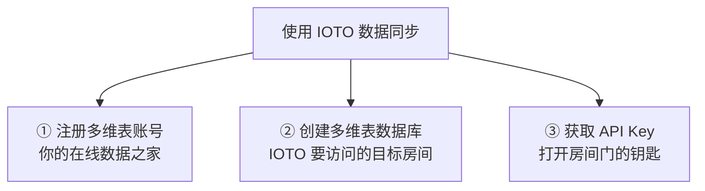

> [!info] 写给打算用数据同步的你
> 这篇文档帮你厘清：在动手把 Obsidian 笔记同步到在线多维表之前，必须先备齐哪三样东西，以及不同平台在"怎么拿到钥匙"上的差异。

---

## 一句话先记住

> [!tip]
> 无论你选哪个平台，动手同步前都只需要备齐三样东西：**账号、数据库、API Key**。平台之间的差异，只体现在"怎么拿到这把钥匙"。

## 数据同步到底是什么

IOTO 的数据同步能力，本质是调用在线多维表平台（如 Airtable、飞书多维表、Notion 等）开放的 API 接口，让 Obsidian 和在线多维表之间实现数据互通。

所以，想让 IOTO 帮你同步，你得先在这些平台上把"家"安好——也就是准备好账号、数据库，以及一把能开门的钥匙。

## 你需要准备的三件事

1. **注册一个多维表账号** —— 你的"在线数据之家"。
2. **创建一个多维表数据库** —— IOTO 最终要读写的目标（一个房间）。
3. **获取一个能访问该多维表的 API Key** —— 让 IOTO 能打开那扇门的钥匙。

### ① 注册账号

注册各平台账号的操作这里不再演示，正常跟着官方引导即可顺利完成。

> [!note] Airtable 用户
> 如果你想注册 Airtable，可以使用我的邀请链接：https://airtable.com/invite/r/d1oZOJGh

### ② 创建多维表数据库

你可以在 IOTO 提供的模板基础上创建你的同步数据表，省去从零设计的麻烦。具体的创建与配置步骤，请查看对应平台的教程。

### ③ 获取 API Key

不同平台在"发钥匙"这件事上，分两种模式：

| 模式           | 适用平台                  | 难度  | 说明                                                    |
| ------------ | --------------------- | --- | ----------------------------------------------------- |
| 直接提供 API Key | Airtable、Baserow、Vika | 较简单 | 注册/创建后直接拿到 Key，基本复制即用                                 |
| 通过自建应用动态生成   | 飞书多维表、钉钉 AI 表格、Notion | 稍麻烦 | 需先建应用 → 绑定表 → 用 APP ID + APP Secret 动态生成（或者APP的Token) |

#### 直接提供 API Key

Airtable、Baserow、Vika 采用这种方式。创建和使用 API Key 的操作更简单，基本是"开箱即用"。

#### 通过用户应用动态生成 API Key

飞书多维表、钉钉 AI 表格、Notion 采用这种方式。你需要先创建一个"用户应用"，再把应用和要访问的多维表绑定，最后通过平台提供的 `APP ID` 和 `APP Secret`（或 Token）动态生成访问钥匙。

这种方式会稍微麻烦一些，但 IOTO 为这些平台都准备了详细的图文教程，照着做即可。

## 用个比喻帮你记牢

> [!info]
> - **账号** = 你的在线数据之家
> - **数据库** = 家里的一个房间（IOTO 要访问的目标）
> - **API Key** = 打开房间门的钥匙
>
> 不同平台只是"锁"不一样：有的是机械锁，有的是电子锁，所以给的"钥匙类型"也不同——有的直接给钥匙，有的要你先装个智能锁（自建应用）再发电子钥匙。