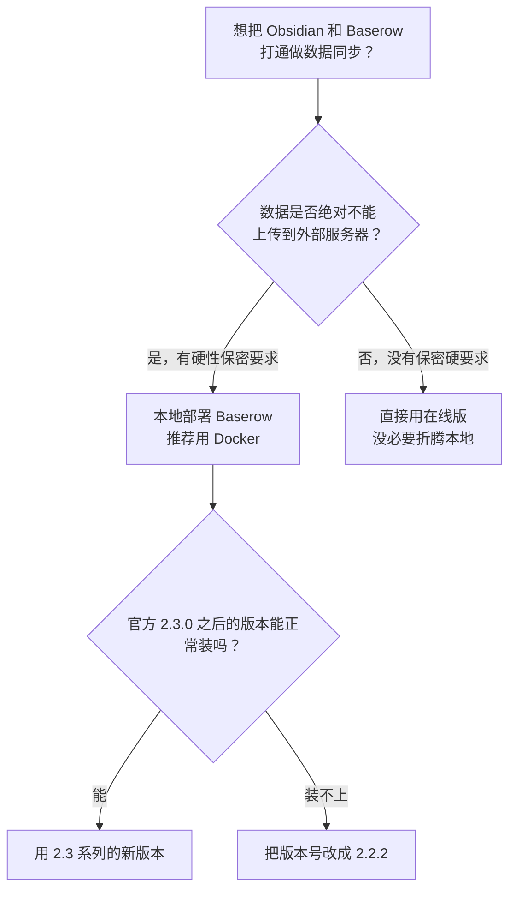

# 写给想要在本地部署Baserow的你

> [!info] 写给想要在本地部署 Baserow 的你
> 在花力气把 Obsidian 通过 IOTO 数据同步和本地 Baserow 打通之前，这篇文档帮你先判断「值不值得这么做」。读完后你会知道：什么情况下该本地部署、什么情况下直接用在线版更省事，以及真要部署时怎么少踩坑。

---

> [!tip] 一句话先记住
> 除非你的数据有**硬性保密要求、绝对不能上外部服务器**，否则直接用 Baserow 在线版或者其他在线版多维表就好，没必要折腾本地部署。真要本地部署，就用 Docker，并且准备好把版本退到 `2.2.2`。

## 先问自己：你真的需要本地部署吗？

本地部署最大的卖点是「数据都在自己电脑里」，但它也意味着你要自己安装、维护。在动手前，先用下面这个判断过一遍：



如果上面这个判断让你倾向于「直接用在线版」，那后面的安装步骤你可以跳过了。

## 两个关键考量

### 1. 数据安全

本地部署最大的吸引力，就是数据全在自己电脑里，不用担心泄密。

- **有硬性保密要求**：如果你的信息真的十分敏感、绝对不能上传到外部服务器，那就去折腾本地部署。
- **没有保密要求**：如果本身就没有客观上的数据保密需求，你真的不用这么麻烦，在线版完全够用。

### 2. 同步速度

本地部署是「自己的电脑和自己的电脑对话」，理论上会快一些。

但说实话，在线版那一两秒的迟钝真的不算什么——实际使用里几乎没有什么影响。为了这点速度去承担本地部署的维护成本，对大多数人并不划算。

## 本地 vs 在线：一张表看懂

| 考量维度 | 本地部署 | 在线版 |
| --- | --- | --- |
| 数据安全 | 数据全在自家电，最安心 | 数据在外部服务器 |
| 同步速度 | 本机对话略快 | 1~2 秒迟钝，几乎无感 |
| 维护成本 | 要自己装、自己维护 | 免安装、即开即用 |
| 适用人群 | 有硬性保密要求者 | 绝大多数普通用户 |

> [!note] 结论
> 只有「数据绝对不能出本机」这一条，才构成本地部署的硬理由。其余情况下，在线版是更省心的选择。

## 如果你真的决定本地部署

那我推荐你用 **Docker**，这是最省事的方式。

**步骤：**

1. 打开 https://www.docker.com/products/docker-desktop/ ，下载 Docker 桌面端。
2. 安装并启动，**不用注册**账号。
3. 访问 https://github.com/baserow/baserow/blob/develop/docs/installation/install-with-docker.md ，拿到官方给出的安装命令行。
4. 在终端里运行安装命令（见下方）。

> [!warning] 版本坑（重要）
> 官方文档示例用的是 `2.3.3` 版本，但我实测 **2.3.0 之后的版本都无法正常安装**。
> 你可以先按官方命令试；如果装不上，就像我一样把版本号改成 `2.2.2`——只需要改命令最后一行镜像的 tag 即可。

完整安装命令（以官方示例的 `2.3.3` 为例）：

```text
docker run \
  -d \
  --name baserow \
  -e BASEROW_PUBLIC_URL=http://localhost \
  -v baserow_data:/baserow/data \
  -p 80:80 \
  -p 443:443 \
  --restart unless-stopped \
  baserow/baserow:2.3.3
```

> [!tip] 装不上就退版本
> 把上面最后一行改成 `baserow/baserow:2.2.2` 再跑一次，是我验证过可用的方案。

---