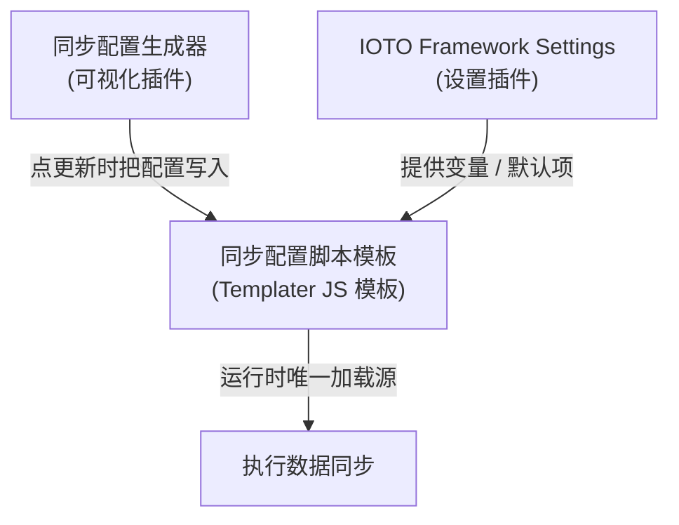

# 同步配置的脚本模板、同步配置生成器还有 IOTO 设置插件中的同步配置到底是什么关系

> [!info] 写给正在配置 IOTO 数据同步的你
> 如果你在折腾多维表同步时，被「同步配置脚本」「同步配置生成器」「IOTO Framework Settings」三处设置搞晕了，这篇就是为你写的。读完你会明白：它们其实是一件事的**三种入口**，运行时最终都落到同一个地方。

---

## 一句话先记住

> [!note] 核心结论
> 运行同步时，**所有信息都从「同步配置脚本模板」里加载**。生成器和设置插件都只是「帮你更方便、更安全地填写这份模板」的入口，并不会自成一套配置。

---

## 三者的角色定位

下面这张图说明它们的关系：



也就是说：

- **同步配置脚本模板** 是地基——真正干活的配置全在这里，用 Templater 支持的 JavaScript 语法写。
- **同步配置生成器** 是「可视化填表器」——不想手写 JS，就用它勾选，点更新即把结果写回模板。
- **IOTO Framework Settings** 是「安全收纳 + 新手快捷入口」——主要管 API Key 和最简初配置。

---

## 为什么需要三个入口？

一个同步功能，本可以只靠一份模板完成全部设置。事实上，**只要有模板，你就已经能完成所有配置了**。

但同步功能能做的事很多，配置本身也有一定复杂度，所以模板用的是 Templater 支持的 **JavaScript 语法**。对很多用户来说，直接改模板里的 JS 很容易写错。

于是才有了另外两个入口，目的都是「降低门槛、减少出错」：

| 入口 | 作用 | 适合谁 |
| --- | --- | --- |
| 同步配置脚本模板 | 承载全部同步配置（JS 语法） | 熟悉配置、想精细控制的人 |
| 同步配置生成器 | 可视化配置，点更新写回模板 | 不想手写 JS 的普通用户 |
| IOTO Framework Settings | 安全存 API Key、给新手最简配置 | 所有人（尤其新手） |

---

## 同步配置生成器：可视化封装

同步配置生成器本质上是对「直接编辑模板」的一层封装：

- 你用图形界面勾选、填写；
- 点「更新」按钮时，它把你填的内容 **写入对应的同步配置模板**；
- 所以生成器 ≠ 独立配置，它的产出就是模板里的内容。

> [!tip] 熟悉之后可以直接改模板
> 当你对配置逐渐熟悉，完全可以直接打开同步配置模板去修改，不必每次都走生成器。生成器只是「更省心」的选项，不是唯一途径。

---

## IOTO Framework Settings：安全与新手友好

设置插件里的同步相关配置，主要服务于两个目的：

**1. 更安全地存放 API Key**

在模板里，通过「加载 IOTO Framework Settings 中的变量」来使用 API Key，这样就不必在模板中明文写出 Key 等敏感信息。

```text
模板中：   const apiKey = `${apiKey}`
而不是：   const apiKey = "sk-xxxx 明文"
```

**2. 让新手免看模板**

最初使用时，完全可以在 IOTO Framework Settings 里做简单配置，实现整库和单数据表的同步，而不用打开同步模板。

---

## 给用户的判断口诀

> [!note] 三句话记住
> - 真要跑同步了，**看的是模板**；
> - 怕写错 JS，**用生成器**；
> - 想藏好 Key、或刚上手图省事，**用设置插件**。
>
> 只要你有信心直接编辑同步模板，就完全可以直接去编辑它——其他方式都是为了简化与防错而存在。

---