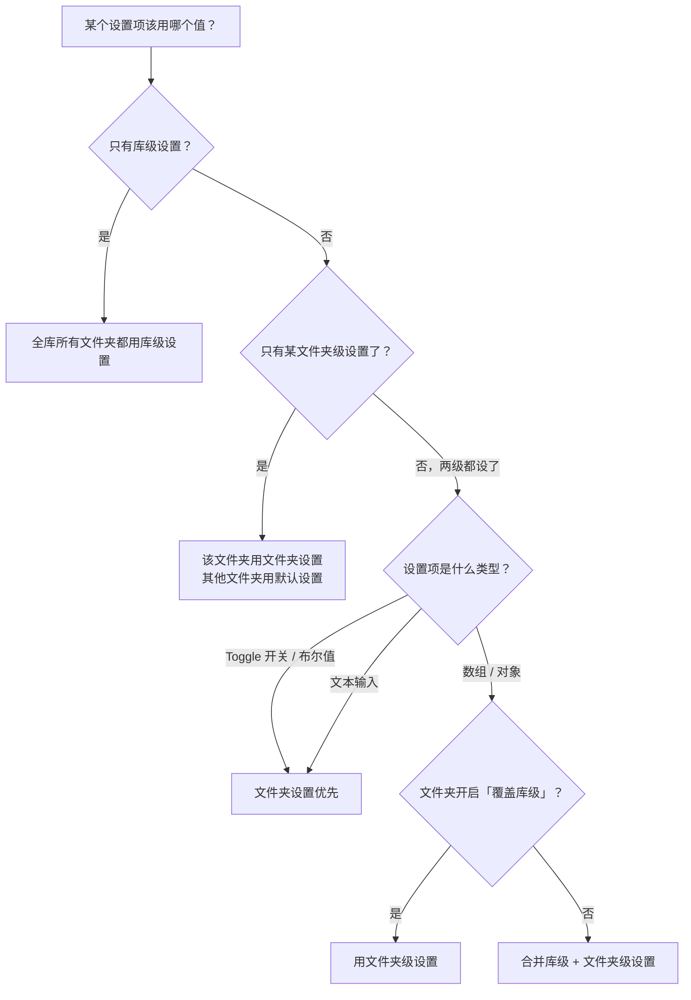

# 如何使用 IOTO 同步设置的必要设置、库级设置和文件夹级设置

> [!info] 写给正在配置 IOTO 同步的你
> 当你打开同步配置生成器，会看到设置被分成了「必要设置 / 库级设置 / 文件夹设置」三类。本文帮你一次搞清它们的区别、各自管什么，以及当设置发生冲突时 IOTO 怎么决定最终结果。

---

## 一句话先记住

> [!tip] 先记结论
> - **必要设置** = 钥匙和房间：没有它，同步根本连不上。
> - **库级设置** = 一处设置，全库生效。
> - **文件夹设置** = 只对某个文件夹生效，比库级更精细，且在它的作用范围内优先级更高。
> - 冲突时：**文件夹级 > 库级**（在它作用的那部分范围里）。

## 三种设置分别是什么

### 1. 必要设置：钥匙与房间

必要设置里只放两件最基础的东西——**访问多维表所需的 API Key**，以及**默认使用的同步数据表信息**。

可以打个比方：

| 概念 | 现实比喻 |
| --- | --- |
| API Key | 钥匙（用来开门） |
| 默认数据表 | 房间（门牌号对应的那间） |

不同多维表平台的区别在于：

- 用的「钥匙」类型不同（认证方式不同）；
- 「房间门牌号」的格式也不同（数据表 ID / URL 的格式不同）。

所以配置时你需要提供的信息会随平台而变，具体请参考每个平台的基础配置教程。

> [!note] 必要设置 vs IOTO Framework Settings
> 这两处几乎一模一样——区别仅在于像 Baserow、Vika 这类支持本地部署的平台，在「必要设置」里多了「本地部署 URL」这一配置项，其余没有差别。
> 为什么要在不同位置都提供设置，详见 [[S8-同步配置的脚本模板、同步配置生成器还有IOTO设置插件中的同步配置到底是什么关系]]。
>
> 实际取值规则很简单：
> - 如果在**同步配置插件**里没有填必要设置 → IOTO 会回退使用 **IOTO Framework Settings** 里的基础同步配置；
> - 如果在同步配置插件里**直接填了值** → 直接用你填的值。

### 2. 库级设置：一处设置，全库可用

库级设置对整个 Obsidian 库生效。

举例：你在库级加了一个自定义字段 `作者`，那么不管你从哪个文件夹发起同步，默认都会带上这个字段。它的意义就是**一处设置，全库可用**。

库级设置分三类：

| 分类 | 管什么 |
| --- | --- |
| **基础** | 常用控制项，主要是一些开关 |
| **高级** | 高级同步项：自定义字段、数据获取字段、附加内容、默认同步字段名称 |
| **提取** | 笔记内容提取类：章节提取、区块提取、标签行提取、要点提取 |

### 3. 文件夹级设置：只对指定文件夹生效

文件夹级设置，顾名思义，只对**你指定的那个文件夹**起作用，比库级更精细。

配置时有一个硬性前提：**必须先指定一个完整的文件夹路径，才能设置其他项**。

最基本的用法就是：给这个文件夹配置它对应的数据表 ID——也就是「把不同文件夹同步到不同数据表」教程里用到的做法。

文件夹设置同样分三类：**基础 / 高级 / 提取**，与库级完全一致。

## 冲突时 IOTO 怎么选

库级和文件夹级最大的区别是**作用范围**，但它们的分类和大量设置项是相同的。当一个设置项在两级都出现时，IOTO 按下面的规则决定最终取值：

文字版同样记一下：

- **只有库级、没有文件夹级** → 全库所有文件夹都用库级设置。
- **只有某文件夹级** → 该文件夹用文件夹设置，其他文件夹用默认设置。
- **两级都有**，按类型分：
  - Toggle / 布尔值 → 文件夹设置优先（直接覆盖）。
  - 文本输入 → 文件夹设置优先。
  - 数组 / 对象 → 若文件夹明确开启「覆盖库级」就用文件夹级；否则把两级**合并**。

## 给新手的配置口诀

> [!tip] 三步不踩坑
> 1. **先填必要设置**：钥匙和房间不齐，后面都白搭。
> 2. **全库通用的放库级**：开关、通用字段，一次设置处处生效。
> 3. **只有个别文件夹要特殊化，才用文件夹级**：记得先写文件夹路径，且数组 / 对象类设置留意「覆盖」开关，避免本想覆盖却被合并。