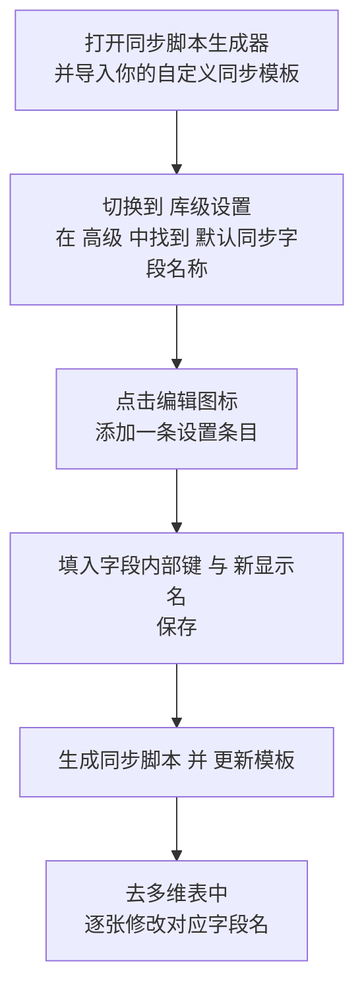

# 如何修改 IOTO 默认的同步字段的名称

> [!info] 写给已经配置好 Airtable 同步、但想让字段名更顺手的你
> IOTO 同步到你多维表里的记录，默认带有 10 个固定字段（标题、内容、库……）。如果你觉得这些名字不符合你的习惯，可以用「同步脚本生成器」把它们改成你想要的名字。本文以把 `标题` 改成 `笔记名` 为例，带你走完整个流程。

---

## 一句话先记住

> [!tip] 核心结论
> 修改默认同步字段名，本质是**在「同步脚本生成器」的「库级设置 → 高级 → 默认同步字段名称」里，给某个字段的内部键（如 `title`）指定一个新的显示名**，生成并更新模板后，再去 Airtable 的每一张同步表里把字段名也改掉。

---

## 为什么会有这 10 个默认字段

在你多维表的同步记录里，有 10 个字段是 IOTO 默认必须有的，它们各自负责存储笔记的不同部分：

| 默认字段名 | 用来存储什么 |
| --- | --- |
| 标题 | 笔记的标题 |
| 内容 | 笔记中「属性之外」的正文内容 |
| 库 | 笔记所在 Obsidian 库的名字 |
| 路径 | 笔记的完整路径 |
| 标签 | 笔记中的标签 |
| 别名 | 笔记的别名 |
| 全文 | 笔记包含属性在内的全部内容 |
| OBURI | 笔记的 Obsidian URI 链接 |
| 创建时间 | 笔记的创建时间 |
| 更新时间 | 笔记的更新时间 |

如果你不喜欢这些默认名字，就可以用 IOTO 提供的「同步脚本生成器」去自定义它们。

---

## 操作流程总览

下面每一步对应总览中的一个节点，跟着做即可。

---

## 第一步：打开同步脚本生成器，导入你的自定义同步模板

打开「同步脚本（模板）生成器」，并在 Airtable 设置页点击「导入」按钮，导入你自己的自定义同步模板（即你之前用前缀命名的那一份）。

---

## 第二步：切换到「库级设置」，在「高级」中找到「默认同步字段名称」

把同步脚本生成器切换到 `库级 设置`，然后在 `高级` 设置项里，找到 `默认同步字段名称` 这一项。

---

## 第三步：把鼠标移入对应输入框，查看设置说明

同步脚本生成器的每个设置都会提供相关说明。在修改默认字段名时，你只需要根据你的需求，去设置想要修改的字段就可以了——把鼠标移入对应的输入框，就能看到该项的设置说明。

---

## 第四步：点击编辑图标，在弹出窗口中添加设置条目

点击 `默认同步字段名称` 右侧的编辑图标，在弹出的窗口中添加一条设置条目。

---

## 第五步：输入字段的内部键与新的显示名，然后保存

每一条设置都由两部分组成：

- **键值（内部键）**：IOTO 内部用来识别这个字段的英文名，例如 `title` 代表「标题」字段。
- **显示值**：你想在多维表里看到的新名字。

比如我们想把 `标题` 改成 `笔记名`，就是把 `title` 的值从 `标题` 改成 `笔记名`，按下图那样填写并保存：

> [!note] 只改你需要的字段
> 你不需要把 10 个字段全部重新设置一遍，只针对想改名字的字段添加条目即可；没设置的字段会继续沿用默认名。

---

## 第六步：生成同步脚本并更新模板

点击 `生成同步脚本` 按钮，在预览窗口里检查设置无误后，点击 `更新` 按钮，把修改内容写入你的自定义同步模板。

---

## 第七步：在你的多维表中，逐张修改对应字段名

最后，回到你的多维表里，把所有正在使用的同步表里的对应字段名也改成新的名字。

> [!warning] 这是「库级」设置，会影响所有同步表
> 默认字段名的设置是**库级**设置，会对你配置的所有同步文件夹对应的数据表同时生效。所以你在 Airtable 这边，也需要**每一张同步表都手动改一遍**字段名，否则新旧名字对不上，同步可能会出错。

---

## 重要提醒

> [!tip] 以后想改别的字段，照做即可
> 如果未来要修改其他默认同步字段，只用按照上面的流程重复操作：找到对应的内部键，添加一条新显示名，生成并更新模板，再去多维表里改字段名。

---