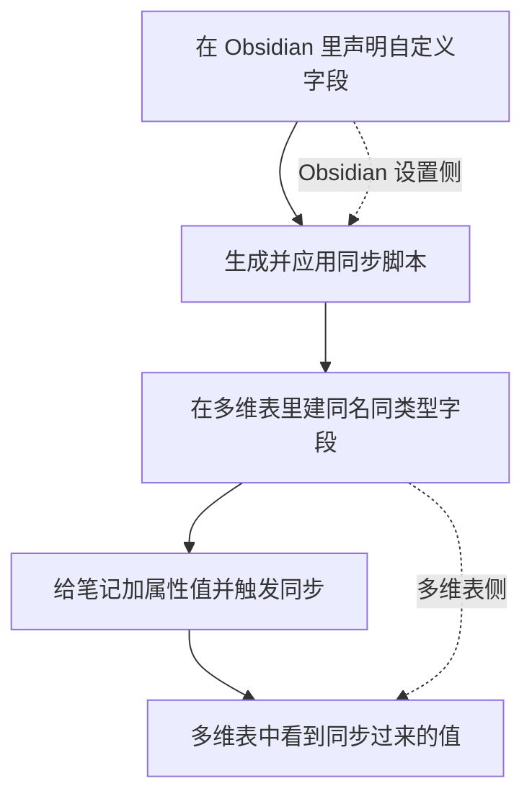

# 如何把指定的笔记属性同步到多维表——自定义字段的使用

> [!info] 写给想把「自己的笔记属性」也同步到多维表的你
> IOTO 默认只会把笔记的**核心内容**同步到多维表的默认字段里。如果你想把**自己指定的其他属性**（比如「类型」「来源」「优先级」）也一起同步过去，就需要用到「自定义字段」。
> 本文以「给输入笔记加一个 `类型` 属性，并同步到 `输入` 表的 `类型` 字段」为例，带你一步步配好。

---

## 一句话先记住

> [!abstract] 核心结论
> 自定义字段要**两边配**：先在 Obsidian 里**声明**要同步哪个属性，再在多维表里**建一个同名、同类型**的字段。两边对上了，同步才会成功。

## 整体流程一览

同步自定义字段，本质上是「Obsidian 设置侧」和「多维表侧」两头各做一半：

下面拆开讲每一步。

## 第一步：打开同步脚本生成器，导入自定义同步模板

## 第二步：在文件夹设置里找到「自定义字段」

切换到 `文件夹设置`，在**输入文件夹**的设置下，进入 `高级` 区域，找到 `自定义字段` 的配置项。

## 第三步：点击编辑，查看设置说明

点击编辑按钮即可设置。和其他设置一样，右侧会显示 `自定义字段` 的说明文案，照着看就行。

## 第四步：添加条目并填写属性信息

点击 `添加条目`，在本例中：
- **属性名**填 `类型`
- **格式**选 `字符串`
- **默认值**留空即可

> [!note] 默认值
> 如果某个字段你希望有一个默认初始值，可以在这里填；没有就留空。

## 第五步：生成并应用同步脚本

保存设置后，点右上方的 `生成同步脚本` 按钮，再点 `更新` 按钮，让新脚本生效。

## 第六步：在多维表里新建对应字段

到 Airtable 的 `输入` 表中，在任意字段上点右键，选择 `Insert left` 或 `Insert right` 插入新字段。

字段类型选 `Single select`（单选）：

输入字段名 `类型`，点 `Create` 完成创建：

## 第七步：测试同步

脚本已更新、多维表字段也已建好，就可以测试了。

在任意输入笔记中加一个 `类型` 属性并填值，按 `Alt+A`（Windows）或 `Option+A`（Mac）同步当前笔记。

> [!tip] 快捷键
> `Alt+A` / `Option+A` 是IOTO同步Airtable默认快捷键，配好自定义字段后用它来验证最方便。

同步成功后，在多维表里就能看到 `类型` 的值已经传过来了：

## 字段类型一定要对应

这是最容易踩坑的地方。**Obsidian 里的属性类型，决定了多维表里字段该用什么类型**——否则会因为传入的数据格式不匹配而同步失败。

| Obsidian 中用的属性类型 | 多维表里可用的字段类型 |
| --- | --- |
| 文本型 | 单行文本、多行文本、`Single select`（单选）、日期型（或其他支持文本内容的类型） |
| 日期 / 日期时间型 | 日期型（Date） |
| 复选框 | 复选框（Checkbox） |
| 列表 | 多选（Multiple select） |

> [!warning] 类型不匹配会同步失败
> 比如 Obsidian 里是「列表」，却在多维表里建了「单行文本」，传入的是数组格式，就会报错。按上表一一对应最稳妥。

## 添加更多自定义字段

如果需要同步其他自定义字段，照上面的流程**重复一遍**即可：先在 Obsidian 声明，再在多维表建一个同名、同类型字段。