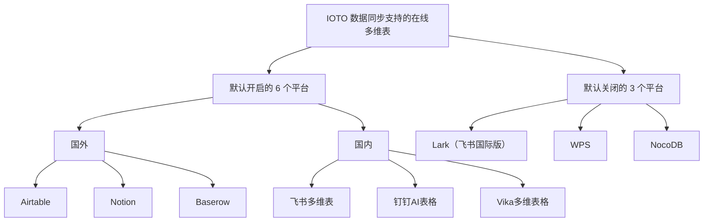
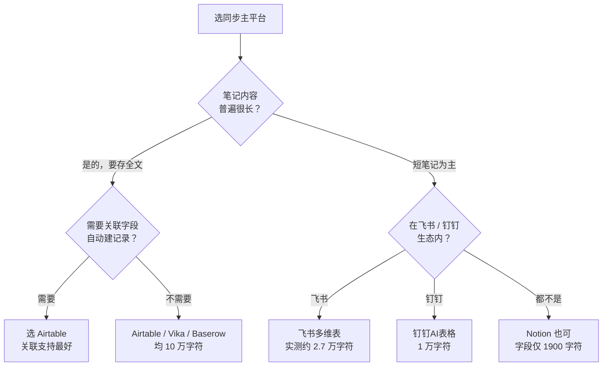

# 如何选择适合你的多维表同步平台

> [!info] 写给准备用 IOTO 数据同步的你
> 你已决定把 Obsidian 笔记同步到在线多维表，但还在纠结选哪个平台？这篇文档帮你快速锁定那个「最省心」的主平台。

---

## 一句话先记住

> [!tip] 给新手的建议
> 绝大多数 IOTO 用户**只同步到一个主平台**，别贪多。选平台看两件事：① 你的笔记有多长（长文本字段容量）；② 你要不要自动建关联记录（目前只有 Airtable 做得好）。拿不准就闭眼选 **Airtable**。

## 先理清两件事

- **IOTO 支持把一篇笔记同时同步到多个平台**，但实际使用中，绝大多数人只挑一个「主平台」长期用。
- **本文的对比视角是「和 IOTO 同步的契合度 + 你的使用成本」**，不是全面的产品/市场对比。如果你想看性能、市占率、前景这些，可让 AI 单独帮你做调研。

> [!note] 一点背景
> 多维表这类产品最早由 Airtable 在 2014 年推出；国内同类产品约 2020 年出现。经过多年发展，各家核心功能都已相对成熟，所以「功能够不够用」通常不是问题，问题往往是「和 IOTO 同步顺不顺」。

## IOTO 支持哪些平台

IOTO 默认支持 **6 个**平台（国外 3 + 国内 3），另外还有 3 个因体验或需求原因被默认关闭。

### 默认开启的 6 个

| 阵营 | 平台 |
| --- | --- |
| 国外 | Airtable、Notion、Baserow |
| 国内 | 飞书多维表、钉钉AI表格、Vika多维表格 |

### 默认关闭的 3 个（及原因）

> [!warning] 为什么默认关掉它们
> - **Lark（飞书国际版）**：功能与飞书多维表一致，但使用 Lark 的 IOTO 用户很少。
> - **WPS**：API 授权方式太麻烦，会拖累使用体验。
> - **NocoDB**：API 接口不规范；当初支持它主要是满足部分学员的本地部署需求，但 **Baserow 可以直接替代**这个需求。

## 核心对比：从哪几个维度看

IOTO 同步时，你主要关心下面三个维度。其中「长文本容量」差异最大，直接决定你能不能把整篇笔记塞进去。

### 维度一：长文本字段容量（决定能存多长的笔记）

把笔记内容同步到多维表时，内容要存在一个「多行文本」类型的字段里。各家单格可存字符数差异巨大，从多到少排列：

| 排名 | 平台 | 单格可存字符数 | 备注 |
| --- | --- | --- | --- |
| 1 | Airtable | 10 万 | — |
| 2 | Vika | 10 万 | — |
| 3 | Baserow | 10 万 | — |
| 4 | 飞书多维表 | 官方称 10 万 | 实际测试约 **2.7 万** |
| 5 | 钉钉AI表格 | 1 万 | — |
| 6 | Notion | 1900 | 见下方说明 |

> [!note] Notion 的特殊情况
> Notion 的多行文本字段确实不能超过 1900 字符。但你可以改把笔记内容写入 **Notion 的文档（Page）** 里——这时要用 Block 方式读写，**速度会慢很多**。如果你的笔记普遍较短，Notion 也能用；要存长文就不太合适。

> [!tip] 怎么按长度选
> - 笔记动辄几千字 → 优先 **Airtable / Vika / Baserow**（10 万字符，最稳）。
> - 用飞书生态 → 飞书多维表能用，但注意实测上限约 2.7 万，超长笔记要留意。
> - 笔记都很短 → Notion 也在可选项内。

### 维度二：对关联字段的同步支持

> [!tip] 结论
> **Airtable 的 API 在这方面的支持最好**：当你同步的内容要写入一个关联字段、而关联表里还没有对应记录时，Airtable 会**自动帮你创建**这条记录。其他多维表产品在这方面的支持都不够好。

如果你要用到关联字段自动建记录，目前基本只有 Airtable 能放心用。

| 产品         | 关联字段类型                                 | 写入时可传明文？     | 不存在时自动创建？ | 实际必须传入的值           |
| ---------- | -------------------------------------- | ------------ | --------- | ------------------ |
| Airtable ✅ | linked record                          | ✅ 可以         | ✅ 自动创建    | 明文或 record id 均可   |
| 飞书多维表      | 单向关联(18) / 双向关联(21)                    | ❌ 不行         | ❌ 不创建     | 被关联表 record_id 数组  |
| Notion     | relation                               | ❌ 不行         | ❌ 不创建     | 已存在页面的 UUID        |
| 钉钉AI表格     | unidirectionalLink / bidirectionalLink | ❌ 不行         | ❌ 不创建     | 已存在记录的 recordId    |
| Baserow    | link_row                               | ✅ 可以（按主字段匹配） | ❌ 不创建     | row id 或主字段文字      |
| Vika多维表    | OneWayLink / TwoWayLink                | ❌ 不行         | ❌ 不创建     | 已存在记录的 recordId 数组 |

核心结论：

- **只有 Airtable 同时支持「传明文」和「自动创建」**，因此在 IOTO 同步关联字段时几乎无需预先建表，体验最好。
- **Baserow 是唯一另一个允许传明文的产品**，但它只是去被关联表里「按主字段查找匹配」，找不到就写入失败 / 不建立关联，**并不会自动新建**记录——这是它与 Airtable 的关键区别。
- 其余 4 个产品（飞书、Notion、钉钉、Vika）都严格要求先传入已存在的 record id / UUID，且都不会自动创建。

### 维度三 & 四：免费版 / 最低档付费版限制

预算敏感时，重点看「能建多少表、每张表能存多少条记录」：

- 免费版限制 → [[S8-IOTO支持的多维表产品的免费版使用限制对比]]
- 最低档付费版限制 → [[S8-IOTO支持的多维表产品最低档付费版的使用限制对比]]

## 怎么选：给新手的判断流程

> [!summary] 判断口诀
> 1. **要自动建关联记录** → 直接 Airtable。
> 2. **笔记长、要存全文** → Airtable / Vika / Baserow 三选一。
> 3. **在国内协同生态** → 飞书多维表（团队用飞书）或钉钉AI表格（团队用钉钉）。
> 4. **预算紧** → 先看 [[S8-IOTO支持的多维表产品的免费版使用限制对比]]，再决定要不要升 [[S8-IOTO支持的多维表产品最低档付费版的使用限制对比]]。