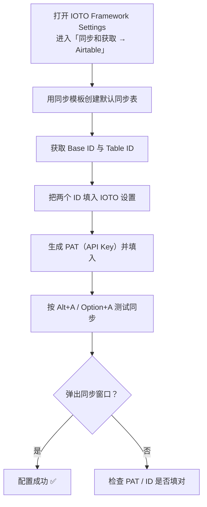

# 手把手教你如何配置 IOTO 与 Airtable 的基本同步

> [!info] 写给刚接触 IOTO 同步功能的你
> 这篇文档带你从零完成 IOTO 与 Airtable 的「基本同步」配置：创建同步表、填入 Base/Table ID、生成 API Key（PAT），最后用一次真实同步验证是否成功。所有操作按顺序排列，跟着做即可。

---

## 一句话先记住

> [!tip] 核心结论
> 基本同步只需要 **4 样东西**：一张用模板创建的 Airtable 同步表 ＋ Base ID / Table ID ＋ 一个 PAT（API Key）。填进 IOTO Framework Settings，再按 `Alt+A` / `Option+A` 能弹出同步窗口，就说明配置成功。

## 开始前先准备

> [!warning] 前置条件
> 在按下面步骤配置之前，请先在**默认浏览器**中注册并登录你的 Airtable 账号。否则后面打开模板或创建 Token 时会被卡在登录环节。

## 配置流程总览



下面每一步对应总览中的一个节点，照着做就行。

---

## 一、进入 Airtable 同步配置页

在使用了 IOTO 的 Obsidian 库中，打开 Obsidian 的设置，在**第三方插件**中点击 `IOTO Framework Settings`，然后点击设置页里的 `同步和获取`，再点击下方的第一个 `Airtable` 标签，即可进入 Airtable 同步的基本设置页。

## 二、用同步模板创建默认同步表

Airtable 同步设置页分为两部分：**同步设置** 与 **获取设置**。现在我们先只关注「同步设置」。

点击设置页中的 `Airtable 同步模板` 这个链接：


> 也可以直接打开这个链接：
> https://airtable.com/app9nXuAbxQ737chI/shraNxwTfJAhvA3b2/tblyRW0kaiMeUMVCz

点击后，会在你的默认浏览器中打开一个 Airtable 的分享页面。在这个页面中，点击右上角的 `Use this data` 这个链接：


之后会弹出一个窗口，让你选择工作区（Workspace）和数据库（Base）：


> [!note] 还没登录？
> 如果你之前没有在默认浏览器里登录 Airtable，这里会先提示你登录，登录成功后再继续。

选择你的工作区，然后再选择一个 Base（也可以新建一个 Base）：


然后，点击 `Create table` 那个按钮：


创建成功后，Airtable 会自动跳转到用模板创建好的数据表。你可以根据自己的需求，修改这个数据表的名字：


## 三、拿到你的 Base ID 和 Table ID

接下来就可以获取这个数据表的 Base ID 和 Table ID 了：


Airtable 一个数据表的 URL 类似：

```text
https://airtable.com/apprMJCMuPugVxxxx/tbl1JTCHDfxbXxxxx/viwkpGeYkrANLoVjW?blocks=hide
```

其中 `app` 开头的部分是 **Base ID**，`tbl` 开头的部分是 **Table ID**。

## 四、把 Base ID 和 Table ID 填入设置

复制这两个 ID，把它们存入到你的 IOTO Framework Settings 的对应设置中：


## 五、获取你的 Airtable API Key（PAT）

在 Airtable 的表格页面，点击左下角的头像，然后在弹出的面板中点击 `Builder Hub`：

> 也可以直接访问这个页面： https://airtable.com/create/tokens


在打开的新页面中，点击左侧的 `Personal access tokens` 选项，然后点击右上角的 `Create token` 按钮：


在出现的页面中，输入一个便于你记忆的 PAT 名字；然后在 Access 设置区，点击 `Add a base`，选择你刚刚创建的表所在的 Base。

> [!warning] 不要图省事选「Add all resources」
> 非特殊情况下，不建议选 `Add all resources`，那会让这个 PAT 的 Key 能访问你账户下**所有**数据库。只授权你新建的那个 Base 即可。


接下来，点击 Scopes 下的 `Add a scope` 链接，在出来的选项中，选择前两个：

- `data.records:read`
- `data.records:write`


然后点击 `Create Token` 按钮：


在随后出现的弹出窗口中，点击复制按钮，获取到你的 PAT Key：


> [!warning] 这个窗口只出现一次
> PAT Key 的复制窗口**只会弹出这一次**。如果 Key 丢失了，可以到 Token 列表里重新生成（Regenerate），再复制一次。


把你拿到的 Key，粘贴到你的 IOTO Framework Settings 的设置中：


至此，IOTO 的 Airtable 同步基本设置就完成了。

## 六、测试同步

打开你 Obsidian 库中任意一篇笔记，然后按 `Alt+A`（Windows）或 `Option+A`（macOS）快捷键：


如果你看到同步的选项窗口，就证明配置成功了。

你可以选择第一个选项 `上传当前笔记到Airtable`，点击后同步成功会有相关提示：


这时候查看笔记的属性，你会看到属性中出现了 `airtableRecordID` 和 `airtableURL` 两项内容：


如果你回到 Airtable 中之前创建的 Table 里，也会看到一条被创建出来的记录：


---

## 重要提醒

> [!note] 当前基本同步的范围
> 当前的设置，会把你**整个 Obsidian 库中的笔记**都同步到同一张表。如果你之后需要按项目/文件夹拆分同步目标，可关注后续更高级的配置说明。

> [!warning] PAT 只显示一次
> 再次强调：PAT Key 的复制窗口只出现一次，请妥善保存；丢失后到 Token 列表重新生成即可。

---