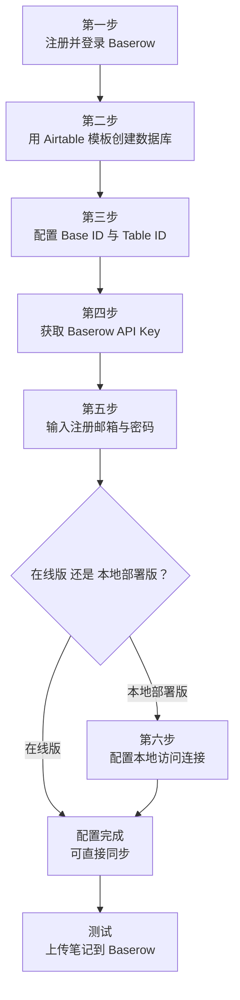

# 手把手教你如何配置 IOTO 与 Baserow 的同步

> [!info] 写给想把 IOTO 笔记同步到 Baserow 的你
> 这篇文档带你从零完成 IOTO 与 Baserow 的同步配置，照着一步步做就能跑通。
> 配置过程中涉及的所有截图都已保留在对应步骤下方，方便你对照自己的界面。

---

## 一句话先记住

> 配置一共六步：注册登录 → 用模板建库 → 填 Base/Table ID → 拿 API Key → 填邮箱密码 →（本地部署才需要）配本地访问地址。其中**只有最后一步「本地访问连接」是本地部署版专属**，在线版到第五步就能直接同步。

---

## 开始之前：本地部署版 vs 在线版

> [!note] 一个关键差异
> 本文演示使用的是 **Baserow 本地部署版**（Docker 运行）。如果你用的是 **Baserow 在线版**，基本流程完全一致，唯一的区别是：在线版**不需要**额外配置「本地访问连接」（第六步），到第五步就可以正常同步了。
> 后面每一步里若涉及这个差异，我会再特别提醒你。

---

## 配置总览

下面这张图把六步串成一条线，你可以先有个整体印象，再往下逐步操作：



---

## 第一步：注册 Baserow 并完成初次登录

即便部署在本地，Baserow 也需要你注册一个账号。

在 Docker 里运行 Baserow 后，访问默认链接 `http://localhost`。如果你还没有注册，会直接跳到注册页面——这是一个典型的邮箱注册页面，按提示一步步操作即可。


输入你的邮箱、用户名和密码。


确认后，会让你创建第一个数据库。你可以按需使用默认名字，或输入自己想用的名字，然后点「继续」按钮。


下一步，需要你创建一个数据表，随便选一个，点「继续」。


之后出现的页面，可以先点 `Skip for now` 跳过。


然后会出现一个演示流程，这个好像无法跳过——你就在开始后一直点「下一步」就行了。


最终，你会看到一个帮你创建的默认数据表。把鼠标放到数据表名称上，右侧会出三个小点，点它然后选 `Delete` 把它删掉。


---

## 第二步：用 Airtable 模板创建新的数据库

IOTO 已经准备好了同步用的 Airtable 模板，照着导入即可。

在 IOTO Framework Settings 的 Baserow 同步设置页，点击 `Baserow 同步模板`，复制打开页面中的链接。

或者直接使用下面的链接：

`https://airtable.com/appsO81hnqzxc3Npg/shrkSVUTPaqNZYyXe`


回到你的 Baserow，点击 `Databases` 右边的 `+` 号，在弹出页面中选择 `Import from Airtable`，在下方输入框粘贴刚才复制的 Airtable 链接，然后点击 `Import from Airtable`。


导入成功后，会出现 `Open imported database` 按钮，点击它。


你会看到 Baserow 帮你创建了一个新的数据库，里面有三个数据表。


把 `简体中文` 那个表，重命名成 `输入`。


---

## 第三步：配置你的 Base ID 和 Table ID

Baserow 的 URL 结构是各类多维表里最简单的。

在 URL 中，`database` 后面两个 `/` 之间的数字就是 **Base ID**，`table` 后面两个 `/` 之间的数字就是 **Table ID**。复制或者记住这两个 ID。


回到 IOTO Framework Settings 的 Baserow 同步设置页，把刚才拿到的两个 ID 输入到对应的位置。


---

## 第四步：拿到 Baserow 的 API Key

回到 Baserow 页面，点击左上角你的工作空间名，在出现的面板中点击 `My Settings`。


在弹出的框中，点击 `Database tokens`，然后点击 `Create token` 按钮。


输入你的 Token 名字，并选择你的工作区，最后点击 `Create Token` 按钮。


在你刚创建的 Token 条目中，点击 `Show databases` 查看 Token 绑定的数据库和数据表。


确保你要使用的数据库和数据表的权限都是开启的。你可以按需灵活配置，第一次使用建议保持默认即可。


然后点击 Token 名字右边的三个小点，在出现的面板中点击复制按钮。


回到 IOTO Framework Settings 的 Baserow 设置页面，把你复制的 Token 粘贴进去。


---

## 第五步：输入你的注册邮箱和密码

> [!warning] 和别的多维表不一样的地方
> 与其他多维表不同，Baserow 在访问它的 API 时，还需要你提供**注册的邮箱和密码**。在 IOTO Framework Settings 的 Baserow 设置区域，录入你使用的邮箱和密码就可以了。


> [!tip] 在线版到此结束
> 如果你使用的是 **Baserow 在线版**，到这一步就可以正常进行基本同步了。
> 如果你使用的是 **Baserow 本地部署版**，还需要继续配置第六步。

---

## 第六步：配置 Baserow 的本地访问连接（本地部署版专属）

这一步的配置需要写到配置文件里。

先找到 IOTO 提供的 Baserow 默认同步模板 [[My-TP-OBSyncBaserow]]。


在这份笔记上点右键，使用 Obsidian 的「创建副本」功能，然后把新建的笔记用你在 IOTO Framework Settings 中配置的**用户模板前缀**改名，作为你自己的自定义模板。


打开同步脚本生成器。

> [!note] 没装过同步脚本生成器？
> 如果之前没有安装过，可以用 IOTO Update 命令进行安装。如果不会，可参考 [[S8-一步步教你如何配置IOTO的4个基本文件夹与不同的Airtable数据表进行同步]] 中的介绍。

在同步脚本生成器中，切换到 Baserow 页面，导入你之前创建的自定义模板。


在 `必要设置` 的最下方，分别录入本地的 `API地址` 和 `数据记录地址的根值`。

如果你使用的是默认配置，它们的值分别是：

```text
API 地址：          http://localhost/api/
数据记录地址的根值：  http://localhost/
```

如果你自己修改了端口或域名，请使用你实际配置的内容。


然后点击 `生成同步脚本` 按钮，在预览窗口中检查自己的配置；如果没有问题，就点 `更新` 按钮进行保存。


---

## 测试配置

你可以在任意笔记中触发 `Alt+B`（Windows）或 `Option+B`（Mac）的默认同步 Baserow 快捷键，然后选择 `上传当前笔记到Baserow`。


同步成功后，你会在笔记的属性中看到 Baserow 的相关信息。


在 Baserow 的数据库中，你也会看到对应的记录。


> [!tip] 跑通了！
> 能看到上面的记录就说明同步配置成功。之后只要在笔记里按 `Alt+B` / `Option+B`，就能随时把笔记推送到 Baserow。

---