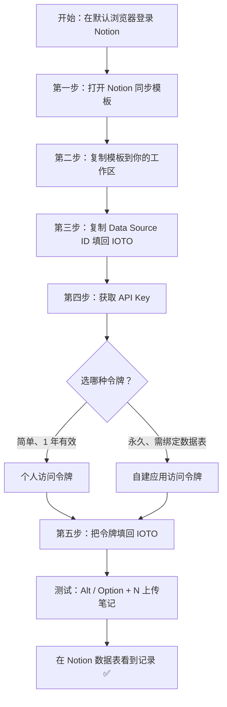

# 手把手教你如何配置 IOTO 与 Notion 的基本同步

> [!info] 写给想要把 Obsidian 笔记同步到 Notion 的你
> 这是一份从零开始的操作手册。跟着下面的 5 步走，你就能把 Obsidian 里的任意笔记一键同步到自己的 Notion 数据表中

---

## 一句话先记住

> 先复制官方同步模板到你的 Notion，再填好 **Data Source ID** 和 **API Key** 两项，之后用 `Alt/Option + N` 就能把笔记同步过去。

## 开始前：先准备好这一件事

> [!warning] 前置条件
> 在按照以下教程配置之前，请先在你的**默认浏览器**中登录你的 Notion 账号。后续复制模板、获取令牌都依赖这个登录态。

## 配置流程总览

## 第一步：打开 Notion 同步模板

在使用了 IOTO 的 Obsidian 库中，打开 Obsidian 设置 → 第三方插件 → 点击 `IOTO Framework Settings` → 设置页中点击 `同步和获取` → 再点击 `Notion` 标签 → 最后点击 `Notion同步模板` 这个链接。

如果链接没反应，也可以直接用下面的地址打开模板：

https://johnnylearns.notion.site/347ceb4f9b9280b58e90c15fec68af11?v=347ceb4f9b9280bf8ff0000ca4ab2bcb

## 第二步：把模板复制到你的 Notion 工作区

点击页面右上角的**复制图标**。

在弹出的页面中，选择你想使用的工作区。

点击**复制**按钮。

复制完成后，你会在自己的工作区里看到一张新的数据表。

## 第三步：拿到 Data Source ID 并填回 IOTO

点击数据表右上角、**新建**按钮左侧的**设置**按钮，然后点击 `管理数据源`。

在出现的页面中，点击你的数据表右侧的三个小点，再点击 `拷贝数据源ID`。

回到 Obsidian 库，在 Notion 同步设置页，把刚复制的数据源 ID 粘贴到 **Data Source ID** 的输入框里。

## 第四步：获取 API Key（两种任选其一）

> [!note] 两种 API Key 怎么选？
> Notion 支持两类令牌，按需二选一即可：

| 对比项 | 个人访问令牌 | 自建应用（链接）访问令牌 |
| --- | --- | --- |
| 获取难度 | 更简单 | 稍麻烦 |
| 有效期 | 最长 1 年，到期需重新获取 | 永久 |
| 是否需要绑定数据表 | 不需要 | 需要（绑定后才能正常使用） |
| 适用场景 | 快速上手、临时/个人使用 | 长期稳定的同步 |

无论选哪种，入口都在开发者门户：点击 Notion 页面右上角的三个小点 → `集成` → `开发者门户`。

### 方式一：个人访问令牌（简单，有效期 1 年）

在开发者门户中，点击左侧的**个人访问令牌**，然后点击 `新令牌` 按钮。

在弹出的窗口中输入令牌名字，选择要同步的数据表所在的工作空间，**到期时间选择 `1年`**，其他保持默认，然后点击 `创建令牌`。

在创建成功弹窗中，复制你的个人令牌。

> [!tip] 选了个人令牌？
> 如果你用的是个人访问令牌，到这里就可以**直接跳到第五步**了，不需要做下面的「自建应用」绑定步骤。

### 方式二：自建应用（链接）访问令牌（永久，需绑定数据表）

在开发者门户页面中，点击 `连接`，然后点击 `新连接` 按钮。

在弹出的窗口中：

- 输入你的连接（应用）名字；
- **验证方式**选择 `访问令牌`；
- 在 `可在以下位置安装` 中，选择你同步表所在的工作空间；
- 然后点击**创建链接**。

在出现的个人链接管理页面中，找到**访问令牌**，点击右侧的复制图标。

> [!warning] 应用令牌必须绑定数据表才能用
> 应用令牌只有在和你的数据表**绑定**之后才能正常使用，别忘了下面这一步。

在你的同步数据表页面，点击右上角的三个小点 → `集成` → 在左侧输入你创建的应用名字 → 点击你的应用。

在出现的对话框里，点击**添加新页面**。

之后你会看到，数据表所在页面的集成数量变成了 **1**，说明绑定成功。

## 第五步：把令牌填回 IOTO 设置

回到 Obsidian 的 Notion 同步设置页，把你在第四步拿到的令牌，粘贴到 **API Key** 的输入框里。

## 测试：上传一条笔记试试

配置完成后，就可以把 Obsidian 里的笔记同步到刚配置的数据表了。

在任意笔记中按 `Alt + N`（Windows）或 `Option + N`（Mac），然后选择**上传当前笔记到 Notion** 进行测试。

同步成功后，你会在 Notion 数据表里看到对应的记录。

---