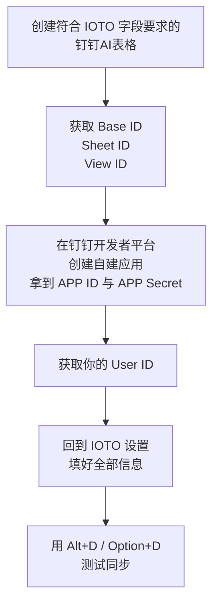

# 手把手教你如何配置 IOTO 与钉钉AI表格的基本同步

> [!info] 写给准备用 IOTO 把笔记同步到钉钉AI表格的你
> 这是一篇一步一步的操作手册，照着做就能完成「基本同步」所需的全部配置。

> [!warning] 先说一句大实话
> 钉钉AI表格是我用过的多维表产品里最「奇葩」的一个，它的同步配置也是 IOTO 目前支持的多维表中**最麻烦的**。如果你不是必须使用钉钉AI表格去同步，建议直接绕道、选择其他产品，能省掉下面这一大堆步骤。

## 配置总览

整个过程可以拆成四步，顺序不能乱：先建好表，再拿表的三个 ID，然后去开发者平台建应用拿凭证，最后补上你的 User ID，回到 IOTO 设置里填好就能测。



---

## 第一步：创建一张符合 IOTO 要求的钉钉AI表格

IOTO 同步到钉钉AI表格时，依赖表里有**固定字段和固定类型**。所以第一步，是先把这张表建对。

### 1.1 打开同步模板页面

在 IOTO 的 Obsidian 库中，打开 Obsidian 设置 → 第三方插件 → 点击 `IOTO Framework Settings` → 进入 `同步和获取` → 点击 `钉钉` 标签 → 点击 `钉钉AI同步模板` 这个链接。

也可以直接打开：

https://alidocs.dingtalk.com/i/nodes/G53mjyd80p7v779wUQNjg4dl86zbX04v?utm_scene=person_space&iframeQuery=viewId%3DJYP28Be%26sheetId%3DrnkKzcV


> [!note] 这个链接没有「复制成模板」按钮
> 钉钉要求**注册企业认证后**才能把 AI 表格分享成互联网公开链接，而作者的账号没有认证。所以这个链接更多是给你「看一眼」——让你知道表里需要有哪些字段、分别是什么类型。要真正建表，请用下面的 AI 提示词。

### 1.2 用 AI 一句话建表

在钉钉AI表格首页的 AI 输入框里，粘贴下面的提示词并发送，它会直接帮你建好一张符合 IOTO 同步要求的表（**不要手动照着字段一个个加**，容易把类型或顺序搞错）：

```text
请创建一个名为「Demo」的数据表，包含以下字段：

标题（主字段，文档类型）
路径（文本）
标签（文本）
别名（文本）
库（单选，选项：选项一、选项二、IOTO）
OBURI（链接）
内容（文本）
创建时间（日期，格式：YYYY-MM-DD HH:mm）
更新时间（日期，格式：YYYY-MM-DD HH:mm）
全文（文本）
字段顺序要求： 标题 → 路径 → 内容 → 全文 → 标签 → 别名 → 库 → OBURI → 创建时间 → 更新时间

视图要求： 创建一个名为「全部数据」的表格视图，显示所有字段，不设置分组、排序和过滤条件。

不要添加示例数据
```


发送后，你就会得到一张符合 IOTO 同步要求的「Demo」数据表。记住这张表，后面几步都要用到它。

---

## 第二步：拿到 Base ID、Sheet ID、View ID

钉钉AI表格的三个 ID 全部藏在表格的 URL 里。打开你刚建好的表，看地址栏。

**Base ID**：在 URL 中 `nodes/` 和 `?` 之间。


**Sheet ID**：在 URL 中 `sheetId%3D` 和后面的 `%` 之间。


**View ID**：在 `viewId%3D` 后面的内容里。分两种情况：
- 如果 `viewId` 是 URL 的**最后一个参数**，取 `viewId%3D` 之后直到结尾的内容；
- 否则取 `viewId%3D` 和后面的 `&` 之间的内容。


拿到这三个 ID 后，回到 IOTO Framework Settings 中对应的位置，把它们填进去。


---

## 第三步：创建自建应用，拿到 APP ID 和 APP Secret

钉钉AI表格通过「自建应用」来授权读写，所以你必须去开发者平台建一个应用，并给它开通对应权限。

### 3.1 创建应用

访问钉钉开发者平台：

https://open.dingtalk.com/

在 `应用开发` 页面点击 `创建应用`。


在弹出的页面里填入应用名称和应用描述，然后点保存。


### 3.2 开通文档读写权限

进入 `权限设置` 页面，滚动到 `文档` 权限设置项。


找到 `AI表格应用读权限` 和 `AI表格应用写权限`，选中它们。


> [!warning] 权限搜索不好用，记得用「批量申请」
> 钉钉AI表格的权限搜索很不好用，所以选中后，滚回页面上方点 `批量申请` 按钮一次性提交，别在下面反复找。


### 3.3 开通通讯录成员读权限

在通讯录管理的设置里，找到 `成员信息读权限`，选中后点 `批量申请` 或 `立即开通`。


### 3.4 发布应用版本

切换到 `版本管理与发布` 页，点击 `创建新版本`。


输入版本号和版本描述，点保存。


然后点 `确认发布`。


### 3.5 复制 APP ID 与 APP Secret

切到 `凭证和基础信息` 页面，复制你的 **APP ID** 和 **APP Secret**。


回到 IOTO Framework Settings，把这两个值粘贴到对应位置。


---

## 第四步：拿到你的 User ID 并填入设置

> [!note] 钉钉AI表格独有的要求
> 钉钉AI表格的同步和其他多维表不同，除了上面的凭证，还需要额外提供你的 **User ID**。

如果你是自己创建的企业（即管理员），可直接访问钉钉管理后台：

https://oa.dingtalk.com/#/welcome

在成员管理页面找到你的 **User ID** 并复制。


回到 IOTO Framework Settings，在「用户 ID」设置里粘贴刚复制的 ID。


至此，钉钉AI表格同步的**基本配置正式完成**。

---

## 测试验证

在任意一个笔记里，用 `Alt+D`（Windows）或 `Option+D`（macOS）触发钉钉AI表格同步功能，选择 `上传当前笔记到Ding`。


如果同步成功，你会在该笔记的属性中看到钉钉AI表格写入的相关信息。


---