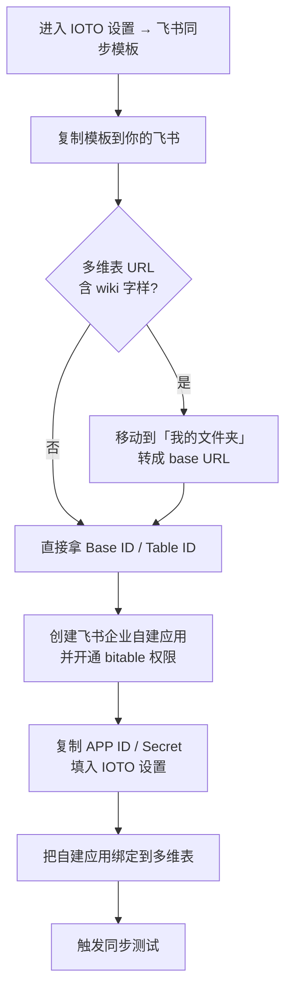

# 手把手教你配置 IOTO 与飞书多维表的基本同步

> [!info] 写给想把 Obsidian 笔记同步到飞书的你
> 本教程带你从零完成 IOTO 与飞书多维表（Bitable）的**基本同步**配置。跟着做完，你就能在 Obsidian 里一键把当前笔记上传到飞书，并在飞书多维表中看到对应记录。

> [!tip] 一句话先记住
> 配置飞书同步，本质就是凑齐「**两个 ID** + **两个 Key** + **一条绑定**」：
> **Base ID / Table ID**（从表 URL 拿）+ **APP ID / APP Secret**（自建应用拿）+ **把自建应用绑到多维表上**。

---

## 开始前你需要准备什么

> [!note] 前置条件
> - 你已安装并启用 IOTO 插件（`IOTO Framework Settings`）。
> - 本教程以飞书**个人版**为例；飞书**企业版**的配置流程与个人版基本一致。
> - 你需要能登录飞书网页端，并访问飞书开放平台。

---

## 整体流程一览

下面这张图把 6 步配置 + 测试串成一条主线，先建立全局印象，再逐节细看。

---

## 第一步：打开飞书同步模板

在你的 Obsidian 库中，打开 **设置 → 第三方插件 → `IOTO Framework Settings`**，点击设置页中的 **`同步和获取`**，再点击下方的 **`飞书`** 标签，然后点击 **`飞书同步模板`** 这个链接。

你也可以直接打开下面的模板链接：

https://johnnylearns.feishu.cn/base/WfHWbLfQQaV6lHsaAu3cyqzonCb?table=tbl7JPPt6WrMjGcf&view=vewtmLQon1

---

## 第二步：把模板复制到你自己的飞书

如果你当前浏览器没有登录飞书，会先提示你登录。

登录后，点击右上角的 **`使用该模板`** 按钮，把模板变成你自己的多维表。

---

## 第三步（按需）：移动多维表，拿到干净的 URL

> [!warning] 什么时候需要做这一步？
> 如果你发现自动创建的飞书多维表 URL 里**包含 `wiki` 字样**，说明它还在「文档库」里，不方便提取 Base ID 和 Table ID。此时需要把它移动出来；如果你的 URL 已经是 `base` 开头，可以跳过本步。

点击右上方的 **三个小点** 图标，然后选择 **`移动到`**。

默认你的多维表可能被放入了 `我的文档库`。在弹出的窗口中选择 **`我的文件夹`**，然后点击 **`确定`**。

这时再打开多维表，URL 中就会是 `base` 字样，可以顺利提取 ID 了。

---

## 第四步：提取 Base ID 与 Table ID 并填入设置

这两个 ID 都藏在多维表的 URL 里，位置如下：

| ID | 在 URL 中的位置 |
| --- | --- |
| **Base ID** | `base/` 和 `?table` 之间 |
| **Table ID** | `?table=` 和 `&` 符号之间 |

**Base ID** 在 `base/` 和 `?table` 之间：

**Table ID** 在 `?table=` 和 `&` 之间：

复制好这两个 ID，回到 Obsidian 的 IOTO 设置中，把它们粘贴到对应的位置。

---

## 第五步：创建自建应用，拿到 APP ID 与 APP Secret

飞书是通过**自建应用**动态生成 API Key 的，所以你需要先到飞书开放平台创建一个企业自建应用（个人版里也叫「企业自建应用」）。

https://open.feishu.cn/app

打开上面的链接，点击 **`创建企业自建应用`**。

在弹出的对话框中输入应用名称和应用描述，然后点击创建。

在打开的页面中切换到 **`权限管理`**，点击 **`开通权限`**，搜索框输入 `bitable`，把出现的**两个权限都选中**，最后点击右下角 **`确认开启权限`**。

接着点击页面中的 **`创建版本`** 提示。

在打开的页面中使用默认版本号，写入一个更新说明，最后点保存。

在弹出的确认框中点击 **`确认发布`**。

最后切换到 **`凭证与基础信息`** 页面，点击 APP ID 和 APP Secret 区域的复制按钮，复制对应的值。

回到 Obsidian 的 IOTO Framework Settings 对应设置区域，把这两个值粘贴到各自的位置。

---

## 第六步：把自建应用绑定到你的多维表

> [!warning] 不绑定会报 403
> 即使前面都填好了，直接触发同步也会收到 **403（没有权限）** 的报错。原因是：我们虽然创建了自建应用，但**没有把它和你的多维表绑定**。这一步就是解决权限问题的关键。

在你的多维表中，点击右上方的 **三个小点**，然后点击 **`更多`**。

在出现的面板中选择 **`添加文档应用`**。

在弹出的对话框中输入你的应用名称，点击对应应用进行选择。

然后在出现的窗口中点击 **`添加`** 按钮。

接下来出现的窗口会显示「已添加的应用」，表示绑定成功。

---

## 测试验证：触发一次同步

回到 Obsidian，打开任意一篇笔记，使用默认快捷键 **`Alt+F`**（Windows）或 **`Option+F`**（Mac）触发飞书同步，选择第一个 **`上传当前笔记到 Feishu`**。

同步成功后，你会在笔记的**属性区**看到飞书的相关信息。

如果你去飞书多维表里查看，也会看到对应的记录。

---

## 配置速查表

| 配置项 | 在哪里拿 | 填到 IOTO 设置的哪里 |
| --- | --- | --- |
| Base ID | 多维表 URL 的 `base/` 与 `?table` 之间 | 飞书同步设置对应位置 |
| Table ID | 多维表 URL 的 `?table=` 与 `&` 之间 | 飞书同步设置对应位置 |
| APP ID | 自建应用「凭证与基础信息」页 | 飞书同步设置对应位置 |
| APP Secret | 自建应用「凭证与基础信息」页 | 飞书同步设置对应位置 |
| 应用绑定 | 多维表「更多 → 添加文档应用」 | 无需填值，绑定即生效 |

> [!tip] 常见坑提醒
> - URL 含 `wiki` → 先移动到「我的文件夹」再提取 ID（见第三步）。
> - 同步报 403 → 多半是忘了第六步「把应用绑到多维表」。
> - 权限开通后记得**创建版本并发布**，否则 APP 不生效。

---