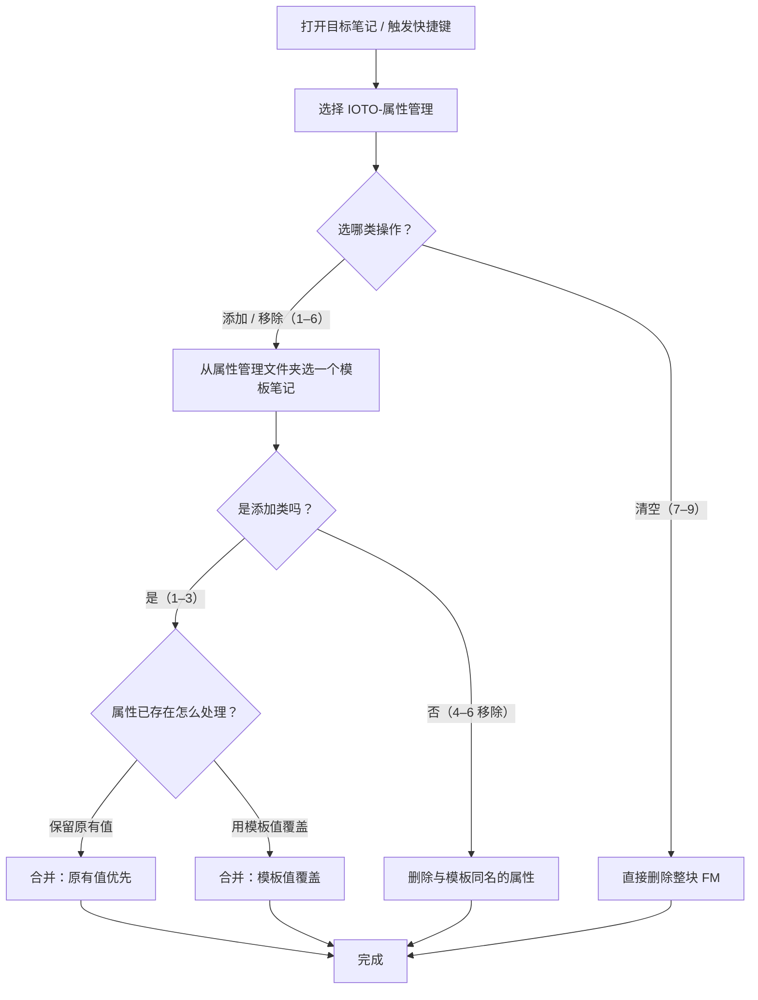

# IOTO 的属性管理功能介绍

> [!info] 写给想要批量维护笔记 YAML 属性的你
> 这篇文档教你用 IOTO 的「属性管理」功能，给**单篇 / 整个文件夹 / 文件夹+子文件夹**的笔记，统一**添加、移除或清空 frontmatter（属性）**。读完你能直接用 Templater 模板完成一次批量属性维护，而不用手动逐个打开笔记改 YAML。

---

## 一句话先记住

> 属性管理 = 在「属性管理文件夹」里放一个**模板笔记**（它的 frontmatter 就是你想要的属性），然后触发辅助工具快捷键，选择用`IOTO-属性管理`给目标笔记**批量套用 / 抽掉 / 清空** YAML 属性。添加时还能选择「保留原值」还是「用模板覆盖」。

---

## 它是什么

IOTO 的属性管理是一个基于 **Templater** 的 frontmatter 批量工具。它把「给一堆笔记统一属性」这件事，收敛成 9 个菜单选项 + 1 个模板笔记：

- **模板笔记**：放在「属性管理文件夹」里，里面只写你希望套用的 frontmatter。
- **目标范围**：当前笔记、当前文件夹、当前文件夹及其子文件夹（3 档）。
- **三种动作**：添加、移除、清空（3 类）。
- 3 × 3 = 9 个选项。

它和「手动在单篇笔记顶部写 YAML」的区别：一次操作可以作用到成百上千篇笔记，且模板可复用。

---

## 前置准备：配置「属性管理文件夹」

在执行添加 / 移除之前，必须先告诉 IOTO「模板笔记放在哪」。


| 设置项       | 说明                        | 默认值                                              |
| --------- | ------------------------- | ------------------------------------------------ |
| `属性管理文件夹` | 存放 frontmatter 模板笔记的文件夹路径 | `0-辅助/IOTO/Templates/Templater/MyIOTO/辅助工具/属性管理` |

> [!warning] 没配置会直接中断
> 如果还没设置该文件夹，运行添加 / 移除类选项时会弹出提示 `Please set IOTO Property Management folder first.` 并退出。清空类选项（第 7–9 项）不需要选模板，所以不受此项限制。
> 配置位置：IOTO 设置插件 → 对应设置项的「属性管理文件夹」。

**怎么做模板笔记？** 在该文件夹下新建一篇笔记，只写你想要套用的 frontmatter，例如：

```yaml
---
Status: 进行中
Author: [ioto]
---
```

这篇笔记本身就作为「属性模板」被引用，正文通常留空即可。

---

## 如何触发

1. 在 Obsidian 中**打开任意一篇笔记**（功能需要一个「当前笔记 / 当前文件夹」作为作用起点）。
2. 在笔记的任意位置触发`Alt+5`或者`Option+5`快捷键
3. 选择 **IOTO-属性管理**。
4. 弹出 9 个选项的菜单，选一个。
5. 若是添加 / 移除类（1–6），会让你从「属性管理文件夹」里**挑一篇模板笔记**作为属性来源。
6. 若是添加类（1–3），还会再问一次：属性已存在时**保留原值**还是**用模板值覆盖**。

> [!note] 必须先打开一个笔记
> 若没有打开任何笔记就运行，会提示 `您必須先開啟一個筆記。`（You must open a note first）。

---

## 9 个选项一览

| # | 选项（中文） | 作用范围 | 动作 |
| --- | --- | --- | --- |
| 1 | 为当前笔记添加指定 FM | 当前笔记 | 添加 |
| 2 | 为当前文件夹下所有笔记添加指定 FM | 当前文件夹 | 添加 |
| 3 | 为当前文件夹及其子文件夹所有笔记添加指定 FM | 当前文件夹 + 子文件夹 | 添加 |
| 4 | 移除当前笔记的指定 FM | 当前笔记 | 移除 |
| 5 | 移除当前文件夹下所有笔记的指定 FM | 当前文件夹 | 移除 |
| 6 | 移除当前文件夹及其子文件夹所有笔记的指定 FM | 当前文件夹 + 子文件夹 | 移除 |
| 7 | 清空当前笔记的 FM | 当前笔记 | 清空 |
| 8 | 清空当前文件夹所有笔记的 FM | 当前文件夹 | 清空 |
| 9 | 清空当前文件夹及其子文件夹所有笔记的 FM | 当前文件夹 + 子文件夹 | 清空 |

> FM = Frontmatter，即笔记顶部的 YAML 属性块。

---

## 三种动作的区别

| 动作 | 对 frontmatter 的影响 | 需要选模板笔记？ | 会问「保留/覆盖」？ |
| --- | --- | --- | --- |
| **添加**（1–3） | 把模板里的属性**合并**进笔记 | 是 | 是（仅添加时） |
| **移除**（4–6） | 只删除笔记中与模板**同名**的属性 | 是 | 否 |
| **清空**（7–9） | 把笔记的**整个 FM 块**删掉 | 否 | 否 |

> [!warning] 清空是不可逆的整块删除
> 清空类选项（7–9）不会按模板筛选，而是**直接删除目标笔记的全部 frontmatter**，且没有任何二次确认。对重要笔记慎用，建议先备份或用 git 版本管理。

---

## 添加时的两种策略（仅添加类 1–3）

当你选了「添加」类选项，IOTO 会再问你：属性已存在时怎么处理？

| 策略 | 行为 | 适用场景 |
| --- | --- | --- |
| **如果 FM 属性已存在，使用原有值** | 仅补充「模板有、笔记没有」的属性；笔记已有的同名属性**保持不动** | 给旧笔记批量补齐新属性，且不破坏已有数据 |
| **如果 FM 属性已存在，使用模板中的值** | 模板值**覆盖**笔记同名属性 | 统一规范化，强制所有目标笔记都采用模板里的值 |

> [!tip] 默认是「保留原有值」
> 默认保护已有数据。只有当你主动选了「使用模板中的值」，才会用模板覆盖。批量规范化旧库时，想清楚再选覆盖。

---

## 操作流程（决策图）



---

## 典型使用场景

- **给项目笔记统一补 `Status` 属性**：写个只有 `Status: 进行中` 的模板，选选项 2/3 + 「保留原有值」，旧笔记自动补齐，已有属性不受影响。
- **统一清理某批笔记的临时属性**：模板里只列要删的属性（如 `temp: xxx`），选选项 5/6「移除」，只抽掉这些属性，其余保留。
- **批量规范化项目归属**：模板写 `Project: ["IOTO"]`，选选项 3 + 「使用模板值覆盖」，把整个子文件夹的 `Project` 强制刷成统一值。
- **重置某文件夹的元数据**：选选项 8/9「清空」，一键删掉全部 frontmatter（务必谨慎）。

---

## 注意事项

- 作用对象只处理 `.md` 文件；非 markdown 文件会被跳过。
- 「移除」是**按模板的属性名**移除，不是清空全部——只删模板里列出的那些属性。
- 「清空」会删掉笔记**整个** frontmatter，且无确认弹窗，对重要笔记先备份。
- 必须先打开一个笔记再运行，否则提示先开笔记。
- 添加 / 移除前必须已配置「属性管理文件夹」，否则提示后直接退出。
- 操作会逐个文件写入并等待元数据刷新（约 100ms/文件），大批量时请耐心等待完成提示。

---