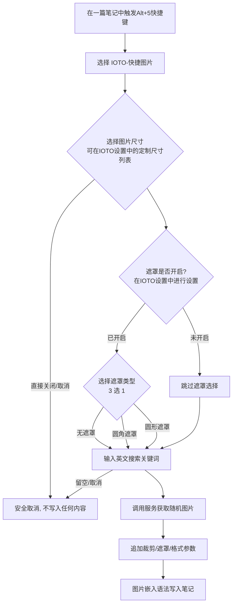

# IOTO的快速图片功能介绍

> [!info] 这是什么
> 「快速图片」是 IOTO 框架提供的一个**辅助工具**，运行在 Templater 之上。它会在你弹出的几个选择/输入框中依次确认**尺寸、遮罩、关键词**，然后调用Unsplash图片服务插入一张**随机图片**的嵌入语法（Embed），并自动加上裁剪与遮罩参数。

## 一句话概览

打开任意笔记 → 触发 `Alt(Option)+5` 快捷键 → 选择 `IOTO-快捷图片` → 选尺寸 →（可选）选遮罩 → 输入英文关键词 → 得到一张根据关键词从Unsplash图库中搜索到的带裁剪/遮罩参数的随机图片。

## 使用步骤

1. 在 Obsidian 中打开你想插入图片的笔记。
2. 在你想要插入图片的位置，点击鼠标左键，然后触发`Alt+5`或`Option+5`快捷键
3. 选择 `IOTO-快捷图片`。
4. 弹出第一个选择框 —— **选图片尺寸**（来自 IOTO 设置中的尺寸列表，见下）。
5. 若 IOTO 设置中**开启了遮罩**，会再弹框让你**选遮罩类型**（无遮罩 / 圆角遮罩 / 圆形遮罩）。
6. 弹出输入框 —— **输入英文关键词**（用于检索随机图片）。
7. 完成，一张带裁剪与遮罩参数的随机图片嵌入语法会被写入模板所在位置。

> [!tip] 中途取消
> 第一步若直接关闭尺寸选择框、或关键词留空，操作会安全取消（`return ""`），不会改动任何内容。

## 两个可配置项（在 IOTO 设置中）

| 设置项      | 类型               | 作用                   | 默认值                                                   |
| -------- | ---------------- | -------------------- | ----------------------------------------------------- |
| `快速图片大小` | 多行文本（每行一个 `宽x高`） | 决定弹出的「尺寸选择框」里有哪些候选尺寸 | `1920x1080` `600x900` `900x600` `600x400` |
| `快速图片遮罩` | 开关（布尔）           | 是否启用「遮罩选择」这一步        | `true`（开启）                                            |

- 尺寸列表按**换行**拆分；你在设置里增删行，弹出的候选就随之变化。
- 关闭 `快速图片遮罩` 后，运行模板会**跳过遮罩选择**，直接让你输关键词。

## 三种遮罩类型

当遮罩开启时，选择框提供：

| 选项（中文） | 内部 mask 值 | 效果 |
|--------------|--------------|------|
| 无遮罩 | 空（不加 `&mask=`） | 原图，仅加裁剪 |
| 圆角遮罩 | `corners` | 图片四角变圆 |
| 圆形遮罩 | `ellipse` | 图片裁成椭圆/圆形 |