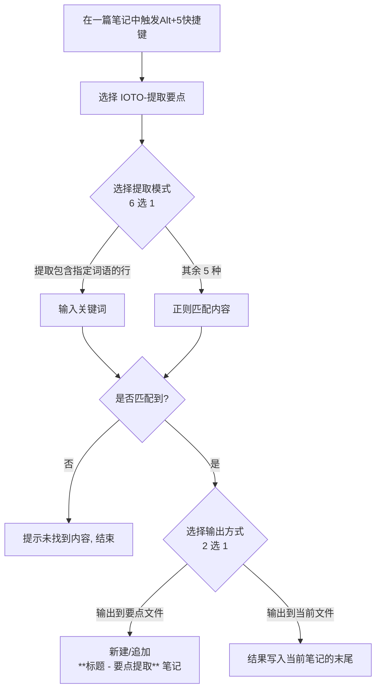

# IOTO的提取要点功能介绍

> [!info] 这是什么
> 「提取要点」是 IOTO 框架提供的一个**辅助工具**，运行在 Templater 之上。它能从当前笔记的正文中，按你选择的规则快速抽出**加粗、高亮、斜体、下划线、标题**，或**包含指定关键词的行**，并整理成可直接使用的要点列表。

## 一句话概览

打开任意笔记 → 触发 `Alt(Option)+5` 快捷键 → 选则`IOTO-提取要点`  → 选「提取什么」→ 选「输出到哪里」→ 得到一份干净的要点。



## 使用步骤

1. 在 Obsidian 中打开你想提取要点的笔记。
2. 触发 `Alt+5` 或者 `Option+5` 快捷键。
3. 选择 `IOTO-提取要点`。
4. 弹出第一个选择框 —— **选提取什么**（共 6 种，见下表）。
5. 若选了「提取包含指定词语的行」，会再弹框让你**输入关键词**。
6. 弹出第二个选择框 —— **选输出到哪里**（要点文件 / 当前文件，见下表）。
7. 完成，结果按你选择的方式落地。

> [!tip] 中途取消
> 第一步若直接关闭选择框、或关键词留空，操作会安全取消，不会改动任何内容。

## 六种提取模式

| #   | 模式（中文）     | 识别的写法              | 提取结果是否保留标记  |
| --- | ---------- | ------------------ | ----------- |
| 1   | 提取加粗内容     | `**文字**`           | 否，只保留 `文字`  |
| 2   | 提取高亮内容     | `==文字==`           | 否，只保留 `文字`  |
| 3   | 提取斜体内容     | `*文字*` 或 `_文字_`    | 否，只保留 `文字`  |
| 4   | 提取下划线内容    | `<u>文字</u>`        | 否，只保留 `文字`  |
| 5   | 提取标题       | `#` ~ `######` 标题行 | 是，保留整行含 `#` |
| 6   | 提取包含指定词语的行 | 任意含该词的整行           | 是，保留整行原文    |

- 模式 1–4、6：每条结果整理为 `- 文字` 形式的**无序列表项**，逐行拼接。
- 模式 5（标题）：直接保留 `# 标题` 原样，按行拼接（不额外加 `-`）。
- 模式 6（关键词）：按「整行」匹配，多个结果之间用空行分隔。

## 两种输出方式

| 输出方式 | 行为 | 当前笔记是否变化 |
|----------|------|------------------|
| **输出到要点文件**（默认推荐） | 在**同文件夹**下新建笔记 `<当前标题> - 要点提取`；若已存在则**追加**内容（用空行分隔） | 不变（模板处不写入任何内容） |
| **输出到当前文件** | 把结果直接写回**当前笔记中模板所在的位置** | 在模板位置插入结果 |

> [!note] 要点文件名
> 新笔记标题取自 `当前文件名 + " - 要点提取"`，与原文同目录，方便成对管理。重复运行不会覆盖，而是不断累积。

## 示例

假设当前笔记正文为：

```markdown
# 项目周报
本周完成了 **核心模块** 的开发，并 ==修复了登录bug==。
重点是 _先保证稳定_，再追求性能。
<u>待办</u>：补充单元测试。
下一阶段关注 AI 与自动化。
```

- 选「提取加粗内容」→ 输出：
```markdown
- 核心模块
```
- 选「提取标题」→ 输出：
```markdown
# 项目周报
```
- 选「提取包含指定词语的行」+ 关键词 `待办` → 输出：
```markdown
<u>待办</u>：补充单元测试。
```