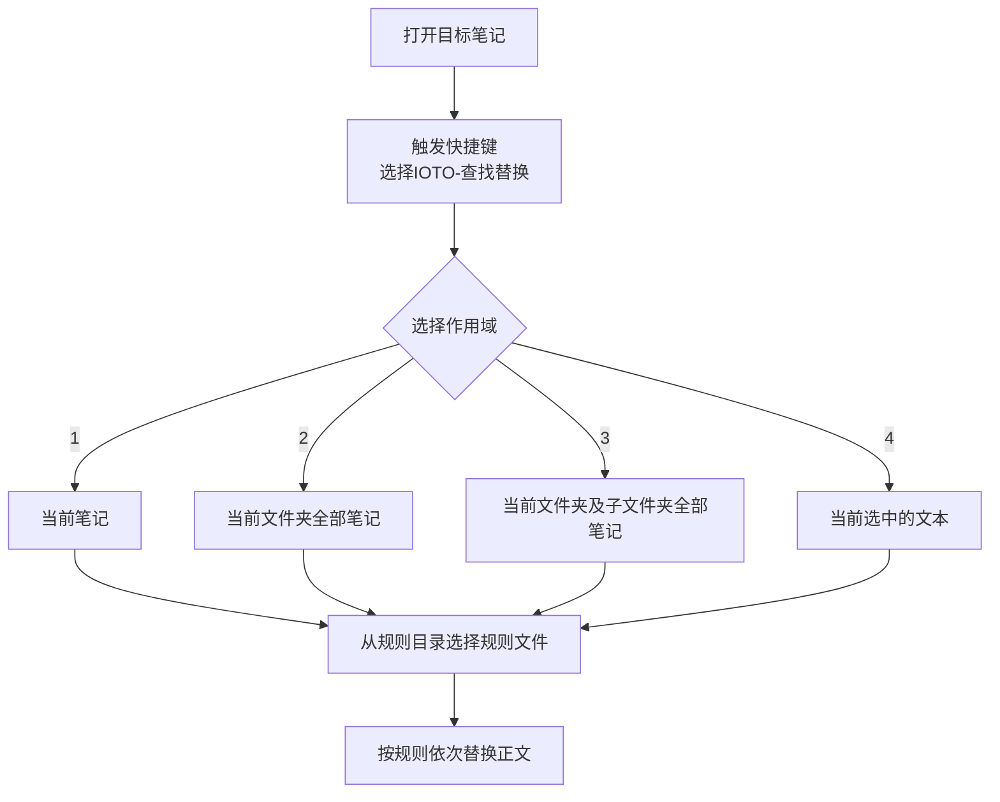

# IOTO的查找替换功能介绍

## 这是什么

IOTO 的「查找替换」是一个在 Obsidian 里**批量改写笔记正文**的辅助工具。它先把一组「查找 / 替换」规则写在一个规则文件里，再让你选择作用范围（当前笔记、当前文件夹、含子文件夹、或选中文本），一次性把规则套用上去。

和Obsidian自带的查找替换不同，它的价值在于：
- 规则可复用——写一次规则文件，之后随时一键套用；
- 规则可批量——一个文件里按顺序执行多条替换；
- 支持正则、忽略大小写、多行模式、整篇或仅首处等开关；
- 只改**正文**，自动避开 YAML frontmatter，不会误伤笔记属性。
- 支持多文件批量操作

## 怎么用

### 第 1 步：准备规则文件

规则文件是一篇 `.md` 笔记，规则**全部写在 YAML frontmatter 里**（详见下文「规则文件」一节）。

规则文件存放在 IOTO设置中 的 `查找替换规则文件夹` 所指向的文件夹。


### 第 2 步：运行命令

在 Obsidian 的**目标笔记**中触发`Alt+5`或`Option+5`快捷键，选择 **IOTO-查找替换**。

> 作用域依赖「当前打开的笔记」来确定文件夹，所以运行前请先打开一篇笔记。

### 第 3 步：选作用域 + 选规则

模板运行后会依次弹出两个选择：

1. **作用域**（4 选 1）：
2. **规则文件**：从规则目录里挑一篇规则笔记。



## 四种作用域

| 选项            | 作用范围                | 备注                               |
| ------------- | ------------------- | -------------------------------- |
| 1. 当前笔记       | 正在编辑的这一篇            | 最常用                              |
| 2. 当前文件夹      | 当前笔记所在文件夹里的全部 `.md` | 不含子文件夹                           |
| 3. 当前文件夹及子文件夹 | 当前笔记所在文件夹及其所有子文件夹   | 用 `path.startsWith(folder)` 递归匹配 |
| 4. 选中文本       | 仅光标选中的那段文本          | 选中为空会提示「请先选择文本内容」                |

> 第 4 种不会改动原笔记，而是把替换结果**输出到正文**（由模板 `tR` 渲染），便于先预览再手动粘贴。

## 规则文件

规则文件就是一篇普通笔记，结构如下（正文仅作说明，脚本只读 frontmatter）：

```markdown
---
search1: 要找的内容
replace1: 要换成的内容
search2: 第二条
replace2: 第二条的替换
ignoreCase: true
globalReplace: true
useRegex: true
multilineMode: false
---
一句话说明这条规则做什么，可选：几行示例文本供当场试跑。
```

### 键名规则

| 键                      | 说明                                             |
| ---------------------- | ---------------------------------------------- |
| `searchN` / `replaceN` | `N` 为数字，**必须成对出现**；缺一个脚本会报「规则不匹配」并整体放弃         |
| 顺序                     | 按 `N` 从小到大**依次执行**，后一条作用在前一条的结果上               |
| 空值                     | `replaceN:` 留空 = 删除；`searchN` 留空则该条被跳过，但配对仍需存在 |
| 编号                     | 建议从 1 连续编号，便于阅读                                |

### 四个开关

四个开关对文件内**所有**规则统一生效，不能逐条设置。

| 开关 | 作用 |
|------|------|
| `useRegex` | `true` 时 `searchN` 按正则解析，`replaceN` 支持 `$1` `$&`；同时给正则加 `u`（Unicode）标志 |
| `ignoreCase` | 忽略大小写。**注意**：只要它为 `true`，即使 `useRegex: false`，搜索串也会走正则通道（内容被自动转义，仍按字面匹配） |
| `globalReplace` | `true` 替换全部匹配；`false` 只替换第一处 |
| `multilineMode` | `true` 时给正则加 `m` 标志，`^` 匹配每行行首、`$` 匹配每行行尾（默认 `false` 只匹配整篇首尾）。**只对走正则通道的规则生效** |

行为矩阵（源码 `searchAndReplaceInContent`）：`flags = g`(globalReplace) + `i`(ignoreCase) + `m`(multilineMode) + `u`(useRegex)。

| useRegex | ignoreCase | 实际行为 |
|---|---|---|
| true | 任意 | `new RegExp(search, flags)`，flags 含 `g`+`i`+`m`(若开)+`u` |
| false | true | 搜索串先转义再编译成正则 → 字面匹配 + 忽略大小写；flags 含 `g`+`i`+`m`(若开) |
| false | false，global=true | `replaceAll(字面串)`（无正则，无 `m`） |
| false | false，global=false | `replace(字面串)`，只换第一处（无正则，无 `m`） |

### 多行模式（m 标志）

- `multilineMode: true` 时，`^` 匹配**每一行的行首**、`$` 匹配**每一行的行尾**；`useRegex: true` 时额外加 `u`（Unicode）标志。
- 该标志**只对走正则通道的规则生效**（即 `useRegex: true` 或 `ignoreCase: true`）；纯字面替换时正则引擎不参与，`m` 不起作用。
- 没有 `m` 时，`^`/`$` 仍只匹配整篇首尾。想按行处理可用兼容写法：`(^|\n)` 配 `$1` 还原换行，行尾用前瞻 `(?=\n|$)`。

```yaml
# 每行行首的裸列表项加待办框（需 multilineMode: true）
search1: ^-\s(?!\[)
replace1: "- [ ] "
multilineMode: true
```

> 注意 `.` 始终不跨行（脚本没有 `s` 标志），所以「整行匹配」写 `\- \[ \] .*` 不论开不开 `m` 都只作用于本行。

### 替换串里的转义

脚本在应用前会做两步字符串替换：`\n` → 真正换行、`\s` → 一个空格。所以「段后加空行」写成 `replace1: $&\n\n`，「补两个空格」写成 `replace1: $&\s\s`。

`$` 系列在**所有模式**下都会被 JS 解释（`$&` 整个匹配、`$1`/`$2` 捕获组、`$$` 字面 `$`）。

### YAML 书写陷阱

写正则时**不要用双引号**——YAML 双引号串里 `\d` `\s` `\-` 等转义会被吞掉。

| 情况 | 写法 |
|------|------|
| 含反斜杠的正则 | 不加引号：`search1: \s\^MLBC.+`；必须加引号时用**单引号**：`search1: '\d+\.'` |
| 以 `-` `?` `:` `[` `{` `#` `>` `|` `*` `&` `!` `%` `@` `` ` `` 开头 | 加双引号：`replace1: "- [ ]"`、`replace1: "## $1"` |
| 值就是单字符 `,` `:` `-` | 加引号：`search2: ","` |
| 替换值以空格开头/结尾 | 写 `\s` 代替真实空格（YAML 会裁掉首尾空白），如 `replace1: $1\s` |
| 搜索值要匹配空格 | 正则模式写 `[ ]` 或 `[ \t]`；字面模式加引号保留空格 |
| 值为空（删除） | 键后留空：`replace1:` |

## 完整示例

**例 1：英文标点换中文标点**

```markdown
---
search1: ;
replace1: ；
search2: ","
replace2: ，
search3: ":"
replace3: ：
search4: \(
replace4: （
search5: \)
replace5: ）
ignoreCase: true
globalReplace: true
useRegex: true
---
把正文中的英文标点批量替换为中文全角标点。注意：会一并替换代码块与链接里的标点，含代码的笔记慎用。
```

**例 2：把无序列表变成待办**

```markdown
---
search1: "-"
replace1: "- [ ]"
ignoreCase: false
globalReplace: true
useRegex: false
---
把 `-` 转成 `- [ ]`。字面替换，正文中所有连字符都会被命中，仅适合纯列表笔记。
```

**例 3：移除所有未完成任务**

```markdown
---
search1: \- \[ \] .*
replace1:
ignoreCase: true
globalReplace: true
useRegex: true
---
删除笔记中所有未完成任务行的内容（保留空行）。
```

## 安全与边界

- 规则只作用于**正文**：`IOTONoteMaker.prepareNoteContent()` 会先剥掉 frontmatter，替换完再原样拼回，不会误伤笔记属性。
- 规则文件里 `searchN`/`replaceN` 不配对，或开关拼出的正则非法，脚本会弹 Notice 并放弃本次替换，不会写出半成品。
- 第 4 种作用域（选中文本）只输出结果、不改原笔记，适合先预览。
- 暴力字符类、无边界的 `.*`、裸 `-`/`=`/`*` 容易造成误伤，写规则时尽量收紧边界、多步拆分。