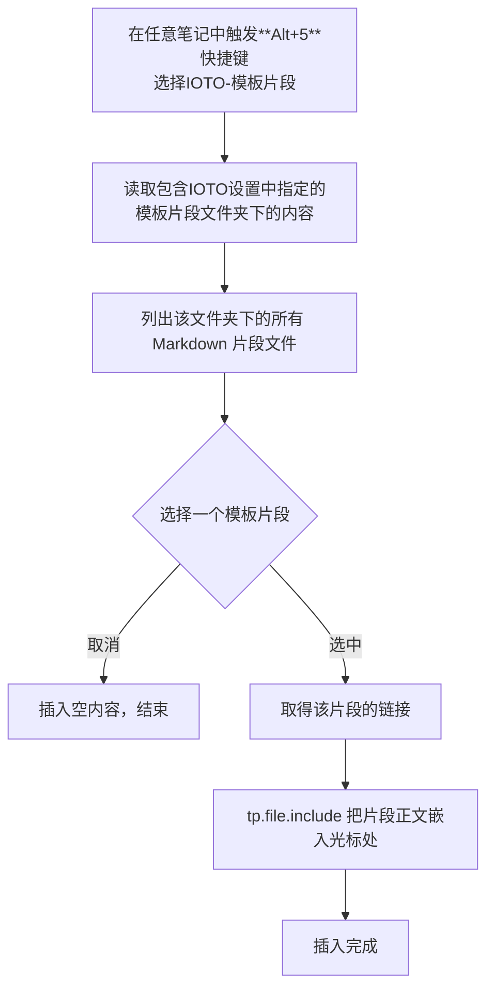

# IOTO的模板片段功能介绍

> [!info] 一句话说明
> **「模板片段」** 是IOTO框架提供的一个辅助工具：运行后从「模板片段文件夹」里挑一个 Markdown 片段文件，把它的正文一键插入到当前笔记的光标处。相当于一个带选择器的「可复用内容粘贴库」。

## 它解决什么问题

写笔记时经常要反复粘贴一些固定内容——常用 callout、表格骨架、章节模板、签名档、免责声明等。与其每次手动复制，不如把这些内容存成独立片段文件，用模板片段功能随时调出、插入。

- 内容集中维护
- 调出时弹出选择器，按文件名挑选，不用记路径
- 定制的模板中可以使用Templater的模板语法

## 它是怎么工作的

执行流程：

## 前置配置

片段所在的文件夹由 ioto-settings 插件的一个设置项决定：

| 设置项（中文） | 默认值                                              | 作用             |
| ------- | ------------------------------------------------ | -------------- |
| 模板片段文件夹 | `0-辅助/IOTO/Templates/Templater/MyIOTO/辅助工具/模板片段` | 存放可复用片段文件的目录路径 |

> [!tip] 如何修改
> 在 Obsidian 设置 → IOTO 设置（`ioto-settings` 插件）中找到「模板片段文件夹」，填入任意 vault 内的文件夹路径即可。设置项是纯路径字符串，修改后立即生效，无需重启。

## 使用步骤

1. **准备片段**：在「模板片段文件夹」里新建 Markdown 文件，每个文件就是一段可复用内容（文件名会出现在选择器里，建议起得直观，如 `常用警告callout`、`会议记录表头`）。
2. **触发模板**：在目标笔记中，触发`Alt+5`或`Option+5`快捷键，选择`IOTO-模板片段`。
3. **选择片段**：弹出的窗口中按 `序号. 文件名` 列出该文件夹所有片段，选中目标。
4. **自动插入**：选中后，片段正文通过 `tp.file.include` 内联到光标处，完成。

## 片段文件怎么写

片段文件就是普通 Markdown，写什么就插入什么。常见用法：

- 固定 callout：`> [!note] ...`
- 表格骨架：空表格模板
- 章节标题 + 占位说明
- 签名 / 免责声明 / 引用来源块
- 支持使用Templater的模板语法

> [!warning] 注意事项
> - **不递归子文件夹**：选择器只扫描配置文件夹的「直接子文件」，子文件夹里的内容不会出现。
> - **仅 Markdown**：非 `.md` 文件不会被列出。
> - **取消即空插入**：在 suggester 中取消选择，会返回空字符串，当前笔记不产生任何内容。
> - **静态嵌入**：通过 `tp.file.include` 插入的是片段当时的正文副本；之后修改片段文件不会自动同步到已插入的笔记。