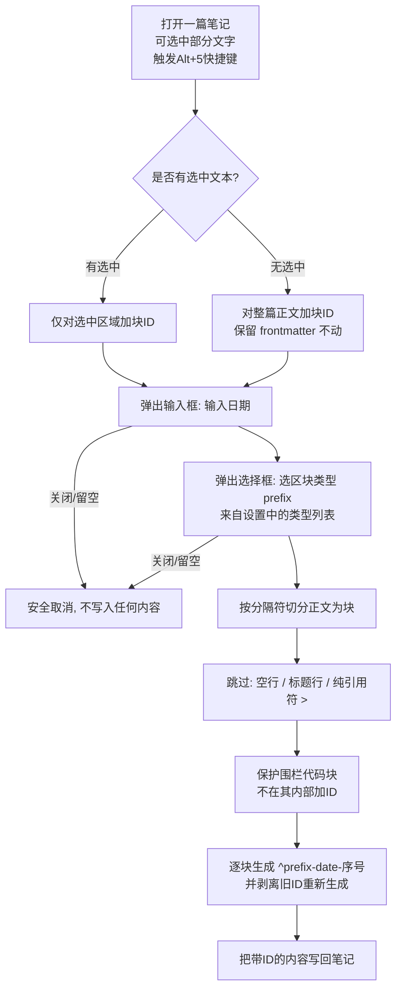

# IOTO的添加区块ID功能介绍

> [!info] 这是什么
> 「添加区块 ID」是 IOTO 框架提供的一个**辅助工具**，运行在 Templater 之上。它会为当前笔记的正文（或你选中的文字）**批量加上 Obsidian 区块引用 ID**（形如 `^code-20260803120000-1`），方便你用 `[[笔记#^code-20260803120000-1]]` 的方式精准引用某个段落，或者使用IOTO的同步功能去提取指定的区块到多维表。

## 一句话概览

打开/选中一篇笔记 → 触发 `Alt(Option)+5` 快捷键 → 选择 `IOTO-添加区块ID` → 输入日期 → 选区块类型（可以在IOTO设置中自定义）→ 正文每个段落都被自动打上递增的块 ID。



## 使用步骤

1. 在 Obsidian 中打开你想加区块 ID 的笔记。
   - 若只想给**某一段**加 ID：**先用编辑器选中那段文字**；否则默认对**整篇笔记正文**生效。
1. 在任意位置触发 `Alt+5` 或者 `Option+5` 快捷键
2. 选 `IOTO-添加区块ID`。
3. 弹出输入框 —— **输入日期**（已预填当前日期，格式由IOTO中的设置决定；可修改）。
4. 弹出选择框 —— **选区块类型 prefix**（候选来自 IOTO 设置中的「快速块类型」列表，见下）。
5. 完成，正文（或选中区域）的每个段落会被打上形如 `^<类型>-<日期>-<序号>` 的块 ID。

> [!tip] 中途取消
> 第 3 步关闭输入框（或留空），或第 4 步关闭选择框（或留空），操作会安全取消（`return ""`），不会改动任何内容。

## 两种作用范围

| 触发条件           | 作用范围                        | 写入方式   | frontmatter 是否受影响  |
| -------------- | --------------------------- | ------ | ------------------ |
| 运行模板前**已选中**文字 | 仅选中的文本区域                    | 替换选区   | 不影响                |
| 运行模板前**未选中**文字 | 整篇笔记正文（不含 YAML frontmatter） | 整体重写正文 | frontmatter 始终原样保留 |

> [!note] 计数范围
> 序号（`-序号`）在「当前作用范围」内从 1 开始递增。对整篇笔记加 ID 时，序号贯穿全篇；只选中一部分时，序号在选中区域内从 1 重新计起。

## 三个可配置项（在 IOTO 设置中）


| 设置名            | 类型             | 作用                           | 默认值                |
| -------------- | -------------- | ---------------------------- | ------------------ |
| 快速块类型          | 多行文本（每行一个类型）   | 决定弹出「区块类型」选择框里的候选 prefix     | `code`<br/>`table` |
| 快速块ID日期格式      | 文本（moment 格式串） | 决定预填日期的格式，如 `YYYYMMDDHHmmss` | `YYYYMMDDHHmmss`   |
| 快速块ID使用单行作为分隔符 | 开关（布尔）         | 决定是否「按单行切分、ID 写在同一行末尾」       | `false`（关闭）        |

- **快速块类型**：每行一个词，会作为块 ID 的 `prefix`。例如默认含 `code` 和 `table`，你就能选 `code` 或 `table` 作为前缀，便于区分这是「代码块」还是「表格块」的引用。
- **快速块ID日期格式**：使用 moment 格式串。修改它能改变块 ID 中日期部分的样子（如改成 `YYYYMMDD` 即只保留年月日）。
- **单行列分隔符**：见下文的「块 ID 的两种写法」。

## 块 ID 的两种写法

按 `快速块ID使用单行作为分隔符`的设置 决定「如何切分段落」以及「ID 写在哪」：

| 设置 | 段落切分依据 | 块 ID 写法示例 | 适用场景 |
|------|--------------|----------------|----------|
| 关闭（默认） | 以**空行**（双换行）分隔的段落 | `这是一段正文。`<br/>`^code-20260803120000-1` | 普通多段落笔记，ID 独占一行，阅读清爽 |
| 开启 | 以**单行换行**（单换行）分隔的每一行 | `这是一行正文。 ^code-20260803120000-1` | 列表/逐行内容，希望 ID 紧贴行尾 |

> 同一段文字在两种模式下结果不同：关闭时是「正文 + 换行 + `^id`」，开启时是「正文 + 空格 + `^id`」。

## 边界与注意事项

- **块 ID 格式**：固定为 `^<prefix>-<date>-<counter>`，例如 `^code-20260803120000-3`。其中 `<counter>` 为当前作用范围内的递增序号。
- **自动跳过的内容**：空行、标题行（以 `#` 开头）、以及「仅含 `>` 的纯引用符行」不会加 ID。
- **代码块受保护**：围栏代码块（``` … ```）会被整体保护，绝不会在其**内部**插入块 ID；代码块本身也不作为加 ID 的对象。
- **重复运行会刷新**：每次运行都会先**剥离已有的块 ID**（正则 `/\s\^[^\s]+/g`），再重新生成，因此重复运行不会产生重复或错乱的 ID，而是重新编号。
- **frontmatter 永不动**：整篇模式下只重写正文，YAML frontmatter 始终原样保留。
- **选中优先**：只要运行前存在非空选区，就只对选区生效，不会波及整篇。
- **取消即不写入**：日期留空、或类型未选（关闭选择框），函数返回空字符串，笔记原样不变。
- **依赖多语言文案**：弹框提示文案由 `IOTOMultiLangs.js` 提供，跟随 IOTO 当前语言。

## 示例

假设 IOTO 设置中：快速块类型为默认 `code / table`，日期格式 `YYYYMMDDHHmmss`，单行列分隔符关闭。在如下笔记正文上运行 `IOTO-添加区块ID`，日期用预填值 `20260803120000`，类型选 `code`：

```markdown
这是第一段正文。

# 这是一个标题

这是第二段正文。
```

运行后变为（标题行与空行被跳过，序号从 1 递增）：

```markdown
这是第一段正文。
^code-20260803120000-1

# 这是一个标题

这是第二段正文。
^code-20260803120000-2
```

随后你就可以用 `[[当前笔记#^code-20260803120000-1]]` 精确引用「这是第一段正文。」这一块。

> 若把「单行列分隔符」开启，则两段会分别写成 `这是第一段正文。 ^code-20260803120000-1` 与 `这是第二段正文。 ^code-20260803120000-2`（ID 紧贴行尾，不再独占一行）。