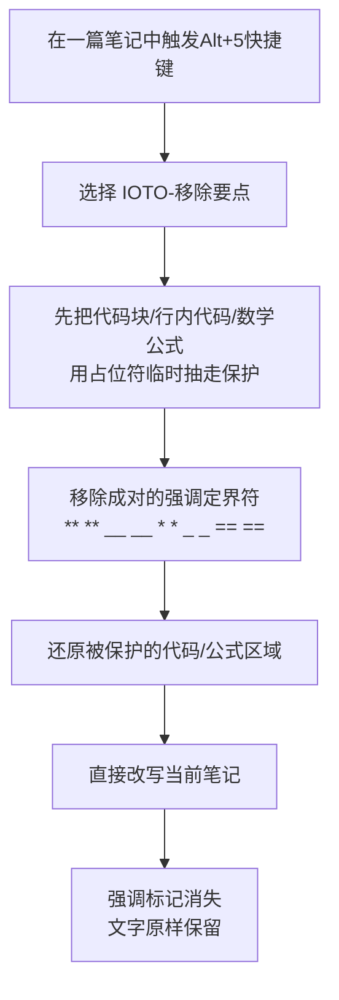

# IOTO的移除要点功能介绍

> [!info] 这是什么
> 「移除要点」是 IOTO 框架提供的一个**辅助工具**，运行在 Templater 之上。它的作用是把当前笔记正文里的**加粗、斜体、高亮**等强调标记**全部去掉，但保留被标记的文字本身**——也就是「只去格式、不动内容」。

## 一句话概览

打开任意笔记 → 触发 `Alt(Option)+5` 快捷键 →  选择 `IOTO-移除要点`  → 当前笔记里所有 **粗体**、*斜体*、==高亮== 等标记被清除，文字原样留下。



> [!warning] 直接改写当前文件
> 与「提取要点」不同，本功能**没有输出位置选择**，运行后会直接修改你正在编辑的笔记。执行前请确认内容已保存；如担心误改，可先 `Ctrl/Cmd + Z` 撤销，或依赖 Obsidian 的文件历史恢复。

## 使用步骤

1. 在 Obsidian 中打开你想清理强调标记的笔记。
2. 在笔记任意位置，触发 `Alt+5` 或者 `Option+5` 快捷键。
3. 选择 `IOTO-移除要点`。
4. 运行完毕，当前笔记里的强调标记即被清除，文字原样保留。
5. 无需任何额外选择，处理是「全笔记一次性」完成的。

## 会移除哪些标记

只移除**成对出现**、用于强调/高亮的定界符，并保留中间的文字：

| 强调类型 | 识别的写法 | 移除后保留的文字 |
|----------|-----------|------------------|
| 高亮 | `==文字==` | `文字` |
| 粗体（星号） | `**文字**` | `文字` |
| 粗体（下划线） | `__文字__` | `文字` |
| 斜体（星号） | `*文字*` | `文字` |
| 斜体（下划线） | `_文字_` | `文字` |

> [!note] 只去定界符，不去文字
> 例如 `**核心模块**` 会变成 `核心模块`，而不是把整段删掉。这是「移除要点中强调」的本意：去掉格式，留下内容。

## 会保护哪些区域

在移除之前，脚本会先用占位符把以下几类区域整体「抽走」，处理完强调后再原样还原，确保它们里的 \*、\=、\_ **绝对不会被误删**：

| 受保护区域 | 写法示例 | 保护原因 |
|------------|---------|---------|
| 围栏代码块 | ` ```...``` ` | 代码里的 `* = _` 是语义字符 |
| 行内代码 | `` `x = a * b` `` | 同上 |
| 数学公式块 | `$$...$$` | 公式符号不可动 |
| 行内数学 | `$E = mc^2$` | 公式符号不可动 |

正因如此，代码、公式、以及其中的 `* = _` 都**不会**被当作强调误删。

## 示例

假设当前笔记正文为：

```markdown
# 会议纪要
本周推进了 **核心模块** 上线，并 ==修复了登录 bug==。
关键点是 _先保证稳定_，再追求性能。
代码：`x = a * b`，公式 $E = mc^2$。
[[我的_笔记]] 与 [文档_v2](http://x.com?a=b)。
```

运行 `IOTO-移除要点` 后：

```markdown
# 会议纪要
本周推进了 核心模块 上线，并 修复了登录 bug。
关键点是 先保证稳定，再追求性能。
代码：`x = a * b`，公式 $E = mc^2$。
[[我的_笔记]] 与 [文档_v2](http://x.com?a=b)。
```

可以看到：**所有强调标记被清除、文字原样保留**；而代码、公式、双链、URL 里的 \*/\=/\_ 全部完好无损。