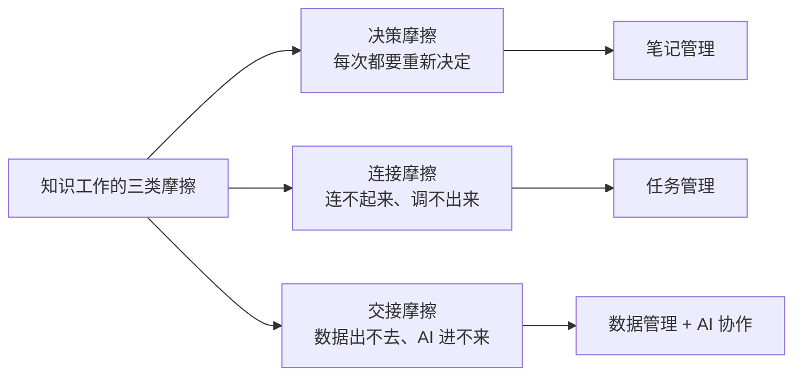
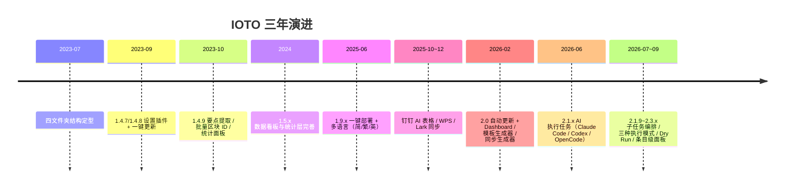

# 用三年去打磨 IOTO，我到底解决了哪些问题

**本文还在更新中，目前的内容不是最终版，仅供参考。**

> [!info] 这篇从哪来
> 起因是我写过一篇很短的卡片 [[IOTO想解决的核心问题是什么]]。那篇文字我只列了四个领域——笔记管理、任务管理、数据管理、AI 协作管理——写完自己都觉得笼统。
> 原因说起来有点可笑：**自己做的东西，反而最说不清。** 天天在里面改，改的每一个细节都记得，反倒看不见它们合起来到底解决了什么。
> 所以这篇是一次"退后三步"的复盘：回到"我当初到底被什么卡住过"，把三年里真正被解决掉的那些问题，一条条捞出来。

---

## 一、先说清楚：我从来没在解决"知识管理"

这句话听起来像是抬杠，但它是理解 IOTO 的钥匙。

**知识是不可管理的。** 你能管理的从来不是知识本身，而是承载它的那些东西——笔记、任务、数据，以及你和 AI 之间怎么分工。

所以 IOTO 解决的不是"怎么管知识"，而是**把知识工作里那些可以被管理的动作，一个个接管掉**。

如果一定要给这三年一个概括，我解决的是三类摩擦：

下面按这三类，逐条展开。

---

## 二、决策摩擦：把"每次都要决定"变成"一次性配置"

### 被卡住的地方

用 Obsidian 的人，最高频的两个问题一定是：

1. 我的库里应该怎么分文件夹？
2. 我怎么把一个笔记快速创建或移动到某个文件夹里？

第一个问题，我用过 PARA，也用过 ACCESS。它们都帮过我，也都有这里那里的不舒服——这很正常，任何方案都有局限，就像别人来用我妈的厨房，也不一定顺手。

第二个问题更隐蔽。Obsidian 默认的三种创建位置（根目录 / 当前文件夹 / 指定文件夹）不够用；打开文件浏览器手动选又太繁琐，高频操作下会不断打断工作流。

真正的问题不在快慢，而是——**"在哪里建"本身就是一次决定，而每一次决定都在消耗精力。** 据说人每天要做三万多个决定。单看每一个都不起眼，加在一起就是一整块被悄悄抽走的注意力。

### 我怎么解决的

**第一层：给文件夹一个不需要再讨论的结构。**

`1-输入`、`2-输出`、`3-任务`、`4-成果`（外加 `0-辅助` 放框架自己的文件）。这五个文件夹是整个 IOTO 里**最稳定的部分，一旦确定几乎不用再改**。

它的底色不是我拍脑袋想出来的，而是 IPOOI 和"学问思辨行"两套东西叠在一起的结果：

| IOTO | 中文 | 知识动作 | 学思行 |
| --- | --- | --- | --- |
| Input | 输入 | 记录 筛选 分类 | 博学见闻 |
| Output | 输出 | 总结 梳理 沉淀 | 慎思致知 |
| Task | 任务 | 计划 执行 复盘 | 预定日新 |
| Outcome | 成果 | 应用 实践 创新 | 笃行耻困 |

这里最关键的一次重新定义，是**把 Output 从"给别人看的"改成了"给未来的自己看的"**。以前我写输出时畏首畏尾，因为潜意识里觉得那是拿出去见人的。一旦承认它只是给未来的自己留的，就没有什么可客气的——有什么就先写什么，先 Put 出来。而 Outcome 的 `Come`，才是要让别人愿意主动走过来的那部分。

**第二层：把创建动作压缩成一个快捷键。**

`Alt(Option)+1/2/3/4` 分别对应输入、输出、任务、成果。按 IOTO 四个字母的顺序排，练成肌肉记忆之后，你基本不再需要打开文件浏览器。

实现它的是一套 Templater 脚本 + 三级模板体系：

- **加载器**（`IOTO-加载器-创建输入/输出/任务/成果`）——入口
- **选择器**——选笔记类型（专题笔记、碎片笔记、卡片笔记……）
- **切换器 / 快速笔记**——为超高频动作定制专属落点

落地时，脚本会自动做三件事，而这三件事原本都是要你手动决定的：

1. 从当前文件夹层级自动提取 `Project` 写入 YAML；
2. 从当前主题任务笔记继承 `Subject`（2.0.3 起）、`Plan`（2.0.5 起）；
3. 创建完成后，自动把 `[[笔记标题]]` 回填到对应项目的 TDL 里（`IOTOAddLinkToTDL.js`）。

**第三层：让用户改得动，又不怕改坏。**

模板分成 `OBIOTO/`（系统默认，建议只读）和 `MyIOTO/`（用户自定义，加 `My-` 前缀）两套，加载时**用户优先**。想改任何逻辑，复制到 `MyIOTO` 改自己的那份，框架升级不会覆盖掉你的定制。

> [!note] 这一层我真正解决的
> 不是"建笔记更快了"，而是：**在这套结构里工作，你不再需要为"放哪、叫什么、用什么模板、填什么属性"这四个问题花一次注意力。** 它们从"每次都要做的决定"，变成了"一次性的配置"。

---

## 三、连接摩擦：双链只是路标，任务才是发动机

### 被卡住的地方

Obsidian 最强的是双链。但用了几年之后我发现一件事：

> **双链解决的是"能连接"，不是"会被调用"。**

你可以把两篇笔记连起来，但没有任何机制逼你去用这条连接。结果就是一堆连着但从来没被走过的路——图谱很好看，知识没有流动。

差的那一环是**情境**。

### 我怎么解决的

**把任务笔记推到 C 位。**

在 IOTO 里，任务笔记不是"第四类笔记"，而是整个系统的驱动中心。项目建在 `3-任务/` 下，每个任务笔记本质就是一个 MOC——它把三件事绑在一起：

- 要交付什么 → 成果
- 现在有什么材料 → 输入
- 已经想到什么 → 输出

任务在知识管理里干了四件实事：**给场景、做筛选、逼交付、产复利。**

因为任务是最关键的那个节点，所以 `Project` 属性是从任务笔记往下继承的：你在一个项目的任务笔记里创建输入/输出/成果，项目属性自动带下去。"项目—任务—IOO"被一条线串起来。

**TDL 不是 To Do List，是 Today's Done List。**

这里我做了一次刻意的认知改写。想着"清单"，你就会想去完成它；想着"待办"，你本能就想拖延。

围绕 TDL，三年里改过不少：

| 时间 | 变化 |
| --- | --- |
| 2023 初版 | 每日 TDL，三段式：输入 LEARN / 输出 THINK / 成果 DO |
| 2023-12（1.4.10） | 支持创建时自定义任务列表名字 |
| 2026-03（2.0.4） | 加入**日期型任务未完成项的自动迁移** |
| 2026-03（2.0.5） | 加入 Plan（计划型）模式，主题型与计划型解绑 |
| 现在 | 推荐使用**按周**的 TDL，四类任务笔记：普通型 / 日期型 / 主题型 / 计划型 |

自动迁移这一条值得单独说。2023 年我明确反对过它——"如果你昨天写下的任务没完成还能安然入睡，那它本来就不该被安排到昨天"。2026 年我还是把它做进去了，因为我承认了另一件事：**日更的 TDL 太重，很多人撑不住；按周组织之后，未完成项的滚动才有意义。** 这是三年打磨里，我被现实纠正的一次。

**任务中心插件（2.0.8 起）。**

我给它的定位一直很克制：**更简单地管理项目和任务**，而不是做一个 Jira。

- 任务状态是**动态**的——由任务笔记里清单的完成状态自动决定，不用手动维护；
- 只提供"优先级 + 核心任务"这类最小设置，刻意不做甘特图、工时、依赖网络；
- 五个默认视图：核心任务 / 今天 / 未完成 / 已完成 / 全部；
- 拖拽设父子任务，右键改优先级；
- 在任务笔记里能直接跳到它的输入、输出、成果出链。

> [!note] 这一层我真正解决的
> 不是"笔记之间连上了"，而是：**有一条始终存在的通路——任务 → 输入 → 输出 → 成果。** 只要这条通路在，知识管理就是把事搞定的副产品，而不是一件需要另外抽时间做的负担。

---

## 四、交接摩擦之一：让数据出得去、回得来

### 被卡住的地方

Obsidian 的本地化是它的优势，也恰恰是它的天花板。这带来四个具体的痛：

1. **管理**：五年前的 OB 没有像样的数据管理。Dataview 很强，但那种近乎编程的语法，学得慢、忘得更快——"绝大部分人，学东西的速度远远赶不上忘记所学的速度"。
2. **分享**：本地文件天然不好分享。
3. **协同**：官方同步要对方也用 OB，Git 就更别指望了。为了协同逼着别人装 OB，那是削足适履。
4. **创作**：原子笔记分开容易，分开之后再合并就麻烦了。而**凡事一旦麻烦，就无法坚持**。

### 我怎么解决的

打通 Obsidian 和多维表，双向同步。

支持的平台一路加到十个：Airtable、Vika、飞书、Lark、钉钉 AI 表格、WPS 轻维表、Notion、Baserow、NocoDB、Seatable。同步设置分四级（**Root → Vault → Folder → File**），通过 `airtableRecordID` 这样的属性维护笔记与记录的对应关系，实现主键匹配下的 INSERT / UPDATE。

踩过的坑都写在了细节里——各家对单格文本长度的限制完全不同：

| 平台 | 单格字符上限 |
| --- | --- |
| Airtable / Vika | 100,000 |
| WPS 轻维表 | 32,500 |
| 飞书多维表 | 20,000 |
| 钉钉 AI 表格 | 10,000 |

这类限制不是查文档查出来的，是内容被截断之后一条条试出来的。

反向也做了：**Fetcher** 系列可以把多维表里的数据拉回 Obsidian（为此还单独发布了三个免费插件：Airtable / Vika / Feishu Fetcher），你也可以先在多位表里用 AI 处理完数据，再拿回 OB 用。

> [!note] 这一层我真正解决的
> 不是"把笔记备份到云端"，而是**四个字：管理、分享、协同、创作**。用 OB 管信息，用多维表管数据，各取所长。我管这个叫"焦虑分离，强强联合"。

---

## 五、交接摩擦之二：让 AI 进得来，而且是带着上下文进来

### 被卡住的地方

这是最近一年才被集中解决的，但痛点其实很早就有了：

> **给 AI 一段散乱的聊天记录，它只能给你"看起来合理"的建议。**

因为 AI 缺三个锚点：要交付什么、现在有什么材料、已经想到什么。

### 我怎么解决的

**第一步：让任务笔记成为人机共享工作台。**

给 AI 一篇任务笔记，它立刻拿到那三个锚点。这也是为什么"AI 执行任务"、"任务中心"全都围绕任务笔记设计——任务笔记既是你的上下文，也是你和 AI 共同的工作台。

**第二步：用 CLI 版智能体实现"点一下就自己跑"。**

图形界面的 AI 做不到无人值守；CLI 版支持无交互模式，而 Obsidian 本身就有"发命令"的能力。所以链路是：

目前支持 Claude Code、Codex CLI、OpenCode、MimoCode、Hermes、CodeBuddy Code、DeepSeek Harness、Pi Agent、Oh My Pi、Qoder（CN / 国际版）。

**第三步：给执行加控制。**

| 能力 | 解决什么 |
| --- | --- |
| 三种执行模式（全文 / 子任务串行 / 子任务并行） | 任务少求简单 / 有依赖求稳 / 相互独立求快 |
| AI 任务预演（Dry Run） | 先看计划，不改写任何笔记 |
| `_project.md` 项目规范 | 每个项目给 AI 定规矩，自动注入提示词 |
| 条目级控制（agent / model / depend / turn / fanout） | 单个任务条目可以单独指定智能体和模型 |
| Token 成本显示 | 让花费可见 |
| 多任务并发查看与控制 | 状态栏显示执行数量，可单独停止、跳转 |
| `IOTO/UserExtensions` | 用户用 Markdown 扩展主技能，升级不覆盖 |

**第四步：把"人要做的事"翻译成"AI 可执行的事"。**

这是最近最重要的一步。`0-辅助/IOTO/Skills/` 下的技能，每一个都对应知识工作流的一个环节：

| 技能 | 对应环节 | 做什么 |
| --- | --- | --- |
| `ioto-llm-input` | 输入 | 把文章/网页/PDF/Word/PPT 清洗后拆成原始资料 + 碎片笔记，双向链接 |
| `ioto-llm-output` | 输出 | 把闪念聚类提炼成卡片笔记，幂等并卡、增量生长 |
| `obsidian-task-executor` | 任务 | 安全执行任务笔记里委派的子任务，复用而非覆盖 |
| `slidesrup-markdown` | 成果 | 把普通笔记转成能直接放映的演示 |
| `ioto-search-and-replace-rule-maker` | 工具 | 把"把 A 换成 B"变成可复用的规则文件 |

这些技能把 IOTO 的规矩（不能新建子文件夹、必须回链来源、先查重再建、标题要含"是什么/为什么/如何"）写进了 AI 的行为里。**AI 不再是一个你复制内容过去对话的外部工具，而是在你的库里、按你的规矩干活的参与者。**

> [!note] 这一层我真正解决的
> 不是"能用 AI 了"，而是：**AI 有了上下文，而上下文的载体是任务笔记，不是聊天窗口。**

---

## 六、那些小到不起眼、但不能没有的东西

有一类功能，平时你完全不会想起它；一旦需要却找不到，眼前再重要的事也得停下来。我给自己的加入标准是三条：

1. 这个功能**确实是我需要的**；
2. 目前**没有现成插件**提供它；
3. 有插件，但那个插件塞了太多我不需要的东西，而我自己实现不算复杂。

| 辅助工具 | 被解决的具体问题 |
| --- | --- |
| 添加区块 ID | OB 默认生成随机 ID，分享出去就失效。改成"有意义缩写 + 时间戳"，所有人拿到的是同一套 ID（这是为米霖书社做的） |
| 提取要点 | 把加粗 / 高亮 / 斜体 / 下划线的内容按类型分别提取成列表 |
| 查找替换 | 规则存在**普通笔记的属性区**里，可以建任意多套、支持正则、可以分享给别人 |
| 属性管理 | 批量增删属性，且**只改 YAML 不动正文**，保证安全 |
| 快捷图片 | 按主题和尺寸插入 Unsplash 图，不用操心版权 |

这类功能的原则就一句：**如无必要，勿增实体。**

---

## 七、三年时间线：问题是怎么一个个被解决掉的

插件版本从 `1.0.0` 走到 `2.3.4`，中间发布了 40 个版本。

但看这条时间线，更有意思的是**重心在移动**：

- **2023 年，我在解决"怎么建笔记"。** 结构、快捷键、模板。
- **2024—2025 年，我在解决"怎么让数据出去"。** 同步、看板、多平台。
- **2026 年，我在解决"怎么让 AI 进来"。** 执行任务、技能体系、编排与控制。

---

## 八、回头看：我刻意没有解决的问题

写出来比写了什么更重要。

**1. 我没有做一个全功能的项目管理工具。**
任务中心刻意不进甘特图、工时统计、依赖网络。IOTO 的核心场景是知识管理，不是替代 Jira。把能力控制在"优先级 + 核心任务 + 状态自动同步"这一层，够用，而且不会让界面变复杂。

**2. 我没有追求 All In One。**
见过太多人信誓旦旦要在 OB 里实现 All In One，结果要么一地鸡毛，要么由爱生恨。世间处处有美好，何苦偏在一地找。

**3. 我没有试图去"管理知识"。**
因为管理不了。我能管的只有笔记、任务、数据，以及和 AI 的分工。

**4. 我还在被现实纠正。**
从"每日 TDL"到"按周 TDL"，从"坚决反对自动迁移"到"把它做进去"——三年里我推翻过自己不止一次。

---

## 结语：答案一直在变，问题没变

如果三年前有人问我"IOTO 在解决什么"，我会说"让在 Obsidian 里建笔记这件事变快"。

现在我会说：

> **IOTO 解决的，是让知识管理不再需要被单独安排。**

它在做的事，是把"决定放哪"变成一次配置，把"连起来"变成"被调用"，把"数据出不去"变成"按你的方式出去"，把"AI 没有上下文"变成"任务笔记就是上下文"。

德鲁克说：**最低效的事，就是用极其高效的方式，去做那些本来就不需要做的事情。**

IOTO 这三年真正想干掉的，就是那些"本来就不需要做的决定"。省下来的注意力，应该拿去思考，拿去休息，拿去产出真正对别人有用的成果。

成果在己，结果在天。**"但行好事"，追求的是成果；"莫问前程"，看淡的是结果。**

以终为始，仅此而已。

---

## 延伸阅读

- [[IOTO想解决的核心问题是什么]] —— 本文的起点，四个领域的原始表述
- [[IOTO功能层级描述]] —— IOTO 的六层能力结构与插件体系
- [[IOTO中的任务笔记为何关键]] —— 为什么任务笔记站在 C 位
- [[IOTO任务中心的定位和使用]] —— 任务中心做什么、不做什么
- [[我为什么要把OB和多维表结合起来]] —— 管理 / 分享 / 协同 / 创作
- [[关于IOTO提供的Skills]] —— IOTO 内置的五个技能
- [[IOTO中AI执行任务功能的三种不同模式]] —— 全文 / 串行 / 并行
- [[IOTO核心快捷键的使用]] —— Alt+1/2/3/4 的正确用法
- [[2023我与IOTO]] —— 一切的起点